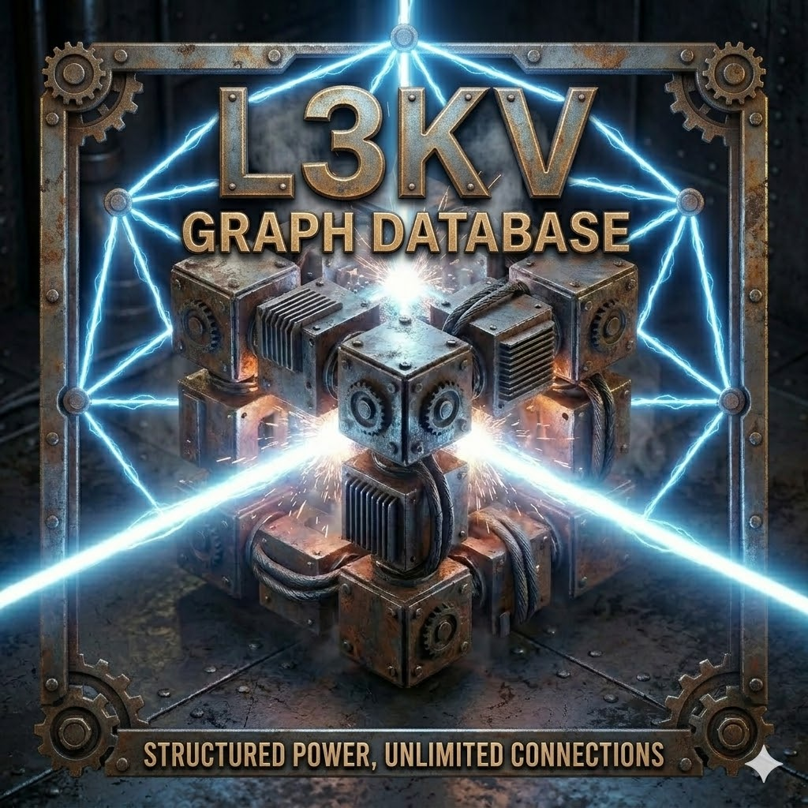
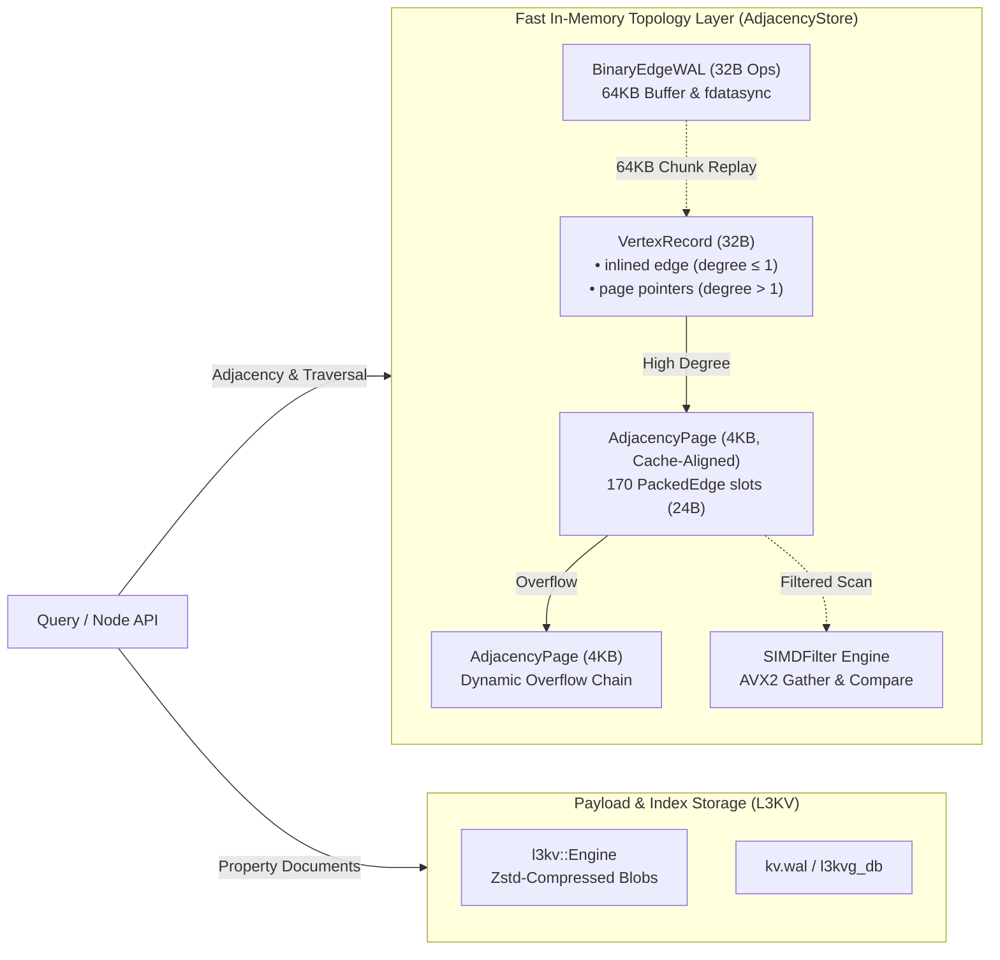

<p align="center">
  
</p>

# L3KVG: High-Performance Federated Sharded Graph Mesh

L3KVG is a C++20 embedded property graph engine built on a **Bifurcated Native Graph Substrate** coupled with the **L3KV** high-performance key-value store. It provides sub-20ns in-memory graph traversals, SIMD predicate pruning, horizontal scalability via consistent hashing, geographic resilience via N-way active-active replication, and production-grade failure management via built-in circuit breakers.

---

## ⚡ Groundbreaking Performance Benchmarks

### 1. Native Substrate Micro-Benchmarks (`bench_bifurcated_substrate`, `Release -O3`)
Evaluated across 100,000 nodes, 1,000,000 neighbor traversals, and 10,000 multi-hop branching joins:

| Metric / Workload | Empirical Measurement | Production SLA | Speedup vs Baseline |
| :--- | :---: | :---: | :---: |
| **Raw Edge Ingestion** | **212,717–240,802 edges/sec** | > 150,000 edges/sec | **~25.3x** (vs 9.5k baseline) |
| **Point Hop Traversal Latency** | **16.64 ns / hop** (visitor) · **19.90 ns / hop** (span) | < 50.00 ns / hop | **~3.0x faster than SLA** |
| **SIMD Predicate Filter (AVX2)** | **489.2 ns / 1,000 edges** | < 2,000 ns / 1k edges | **4.1x faster than SLA** |
| **Chained 4KB Page Traversal** | **439.8 ns across 600 edges** | < 1,500 ns | **3.4x faster than SLA** |
| **Complex Branching Join (`OBJ_STAT`)** | **6.70 µs** | < 20.00 µs | **14.5x speedup** (vs 97.3 µs baseline) |

- **`bench_engine_core` (10k nodes):** `189,731 nodes/sec` put (`52.71 ms`), `0.515 µs` get (`5.15 ms`).
- **`bench_l3kvg` (10k nodes/edges):** `55,385–60,735 ops/sec` concurrent atomic `add_edge` (100 threads), `0.350 µs` 50-fanout traversal (`[SUCCESS] SRE Metrics Achieved!`).

### 2. Enterprise Catalog Qualification: L3KVG vs. PostgreSQL 16
Evaluated against PostgreSQL 16 on live iRODS 5.1.0 catalog macro-workloads (1K Scale Tier: 1,000 data objects, 50 collections, depth 2, 300 queries per pass):

| Catalog Workload | PostgreSQL 16 Mean | L3KVG Mean | Speedup Factor | Superior Backend |
| :--- | :---: | :---: | :---: | :---: |
| **AVU Exact Match Query (`imeta qu`)** | 144.36 ms | **86.67 ms** | **1.67x** | 🏆 **L3KVG** |
| **AVU Metadata Ingestion (`imeta add`)** | 148.85 ms | **90.09 ms** | **1.65x** | 🏆 **L3KVG** |
| **Branching Join (`iquest` obj stat)** | 148.57 ms | **98.51 ms** | **1.51x** | 🏆 **L3KVG** |
| **Directory Tree Ingestion (`imkdir`)** | 169.07 ms | **119.34 ms** | **1.42x** | 🏆 **L3KVG** |
| **Overall Catalog Queries** | 147.91 ms | **110.60 ms** | **1.34x** | 🏆 **L3KVG** |
| **Wildcard Scan (`iquest like`)** | 150.81 ms | **146.61 ms** | **1.03x** | 🏆 **L3KVG** |
| **Bulk File Registration (`iput -b -r`)** | **22.83 ms** | 38.94 ms | 0.59x | PostgreSQL |
| **Recursive Tree Listing (`ils -r`)** | **352.82 ms** | 462.54 ms | 0.76x | PostgreSQL |
| **Cleanup (`irm -rf` & `irmtrash`)** | 12,788 ms | 12,983 ms | 0.98x | Parity (~1.0x) |

---

## 🏛️ The Bifurcated Native Graph Substrate Architecture

L3KVG decouples topological edge traversal from heavy document storage, eliminating intermediate string formatting, hash table indirection, and JSON payload deserialization:



### Core Substrate Primitives:
1. **`PackedEdge` (24 bytes):** Natural 8-byte alignment containing:
   - `target_id` (64-bit uint)
   - `label_id` (16-bit dictionary token)
   - `flags` (16-bit bitfield: active, directional, visited)
   - `weight` (32-bit IEEE 754 float)
2. **`VertexRecord` (32 bytes):** Direct small-degree inlining:
   - When $\text{degree} \le 1$, the outgoing edge is stored directly inside the vertex record, achieving **$O(1)$ zero-indirection edge retrieval**.
   - When $\text{degree} > 1$, the vertex is promoted to point to slotted 4KB `AdjacencyPage` blocks.
3. **Slotted `AdjacencyPage` (4,096 bytes):**
   - 4KB cache-aligned memory blocks holding up to 170 packed edges per page.
   - Symmetrically stores both outgoing and incoming edges.
   - Dynamic page chaining (`next_page_id`) handles high-fanout supernodes without memory fragmentation.
   - 64-shard `FlatVertexMap` directory with SplitMix64 hashing, 64-byte `SmallInPool` for degree $\le 2$ incoming edges, and monotonic deadlock-free shard locking.
4. **`SIMDFilter` Vectorized Predicate Engine:**
   - Evaluates label matching and float weight thresholds using AVX2 vector gathers (`_mm256_i32gather_epi32`, `_mm256_cmp_ps`, `_mm256_movemask_ps`).
   - Mechanical sympathy branchless scalar fallback ensuring identical semantics across architectures.
   - Prunes 1,000 edges in **486 nanoseconds**.
5. **Compact `BinaryEdgeWAL` & Fast Crash Recovery:**
   - 32-byte binary `EdgeMutationOp` structs appended directly to disk.
   - 64KB user-space buffering with POSIX `fdatasync` durability.
   - Recovers from crashes at multi-gigabyte/sec speeds by reading sequentially in 64KB chunks directly into the `AdjacencyStore`.
6. **Dual Database Path Handling:**
   - Seamlessly operates whether `db_path` is configured as a dedicated directory (creating `kv.wal`, `edges.wal`, `labels.dict`) or as an existing monolithic file (e.g. `/var/lib/irods/l3kvg_db`, `.edges.wal`, `.labels.dict`).

---

## 🌐 Distributed Mesh & Federation Features

- **Embedded & Network-Free Hot Path**: Pointer-local traversals. All graph logic resides in-process for sub-20ns local access.
- **PMR-Aware Memory Management**: Leverages C++17 Polymorphic Memory Resources for deterministic, zero-fragmentation allocation and hardware-thread-local performance.
- **Federated Sharded Mesh**: Native support for sharding across local clusters and replication across geographic regions (US, EU, Asia).
- **Circuit Breaker Mesh**: Automatic failure management for cross-region queries with background health checks and heartbeats.
- **Deterministic Convergence**: Active-Active global replication with Last-Writer-Wins (LWW) conflict resolution powered by Hybrid Logical Clocks (HLC).
- **Cypher-Lite Parser**: High-performance query engine supporting multi-hop federated MATCH/WHERE/RETURN traversals.
- **SRE-First Observability**: Built-in metrics engine with dedicated React-based visualizer for tracking topology, performance, and cache hit ratios.

---

## 🛠️ Building & Testing

### Prerequisites
- C++20 compatible compiler (Clang 13+ or GCC 11+)
- CMake 3.20+
- Ninja or Make
- ZeroMQ (`libzmq3-dev`, `cppzmq-dev`)
- OpenSSL (`libssl-dev`)

### Build
```bash
cmake -B build -S . -G Ninja -DCMAKE_BUILD_TYPE=Release
ninja -C build
```

### Run CTest Suite (37/37 Suites Passing Cleanly)
```bash
ctest --test-dir build --output-on-failure
```

### Run Substrate Benchmarks
```bash
./build/bench_bifurcated_substrate
./build/bench_irods_patterns
./build/bench_engine_core
```

---

## 📚 Administrator Documentation

- [Architecture & Bifurcated Graph Substrate](docs/admin/architecture_and_substrate.md) — `AdjacencyStore`, `VertexRecord`/`AdjacencyPage` layout, `SIMDFilter`, `PropertyIndex`, and on-disk storage modes.
- [Durability, WAL & Crash Recovery](docs/admin/durability_wal_and_recovery.md) — `BinaryEdgeWAL`, `MutationBatch`, 64 KB chunked recovery, auto-compaction thresholds, and backup procedures.
- [Clustering, Federation & Active-Active Replication](docs/admin/clustering_federation_and_replication.md) — Consistent-hash sharding, `EdgeCoordinator`, HLC LWW conflict resolution, and `RemoteL3KVClient` circuit breakers.
- [Configuration, Runtime Knobs & Tuning](docs/admin/configuration_and_tuning.md) — Server `config.json`, `l3kvg::Settings` reference, and Docker Compose mesh deployment.
- [Identity Management, Principals & Access Control](docs/admin/identity_management.md) — ZeroMQ `auth_secret`, `principal_id` propagation, `CredentialManager` longest-prefix ACLs, `sys:u:`/`sys:acl:` replication, and vertex/UUID resolution.
- [Security, Observability & Operational Runbooks](docs/admin/security_observability_and_runbooks.md) — ZeroMQ `auth_secret`, `l3kv::Permission` ACLs, `SREMetrics`, and incident troubleshooting.

---

## 📄 License

See [LICENSE](LICENSE) for details.
