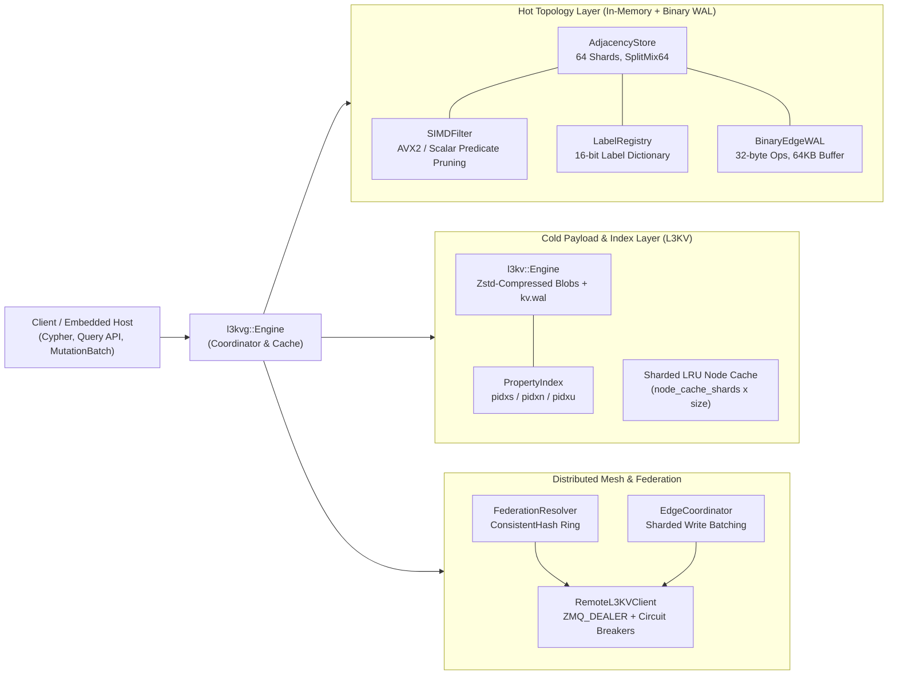
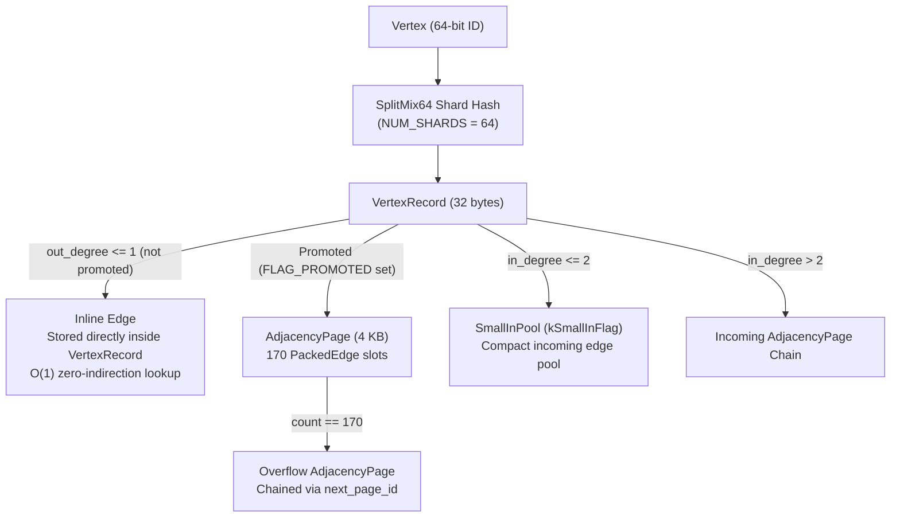

# L3KVG Architecture & Bifurcated Graph Substrate

`l3kvg` is a C++20 embedded and networked property-graph engine designed around a **Bifurcated Native Graph Substrate**. Instead of storing graph edges as JSON/BSON documents inside a generic key-value store, `l3kvg` separates **hot topological adjacency** (in-memory, cache-aligned, SIMD-filtered) from **cold property payloads and secondary indexes** (persisted in `l3kv::Engine` with Zstd compression).

For administrators, this separation means **graph traversals stay pointer-local and sub-20ns**, while **document payloads, property indexes, and ACLs** inherit the durability, compression, and sharding of `l3kv`.

---

## 1. High-Level System Architecture

---

## 2. Hot Topology Layer (`AdjacencyStore`)

Defined in [AdjacencyStore.hpp](file:///home/darkfell/dev/l3kvg/include/L3KVG/AdjacencyStore.hpp) and [PackedEdge.hpp](file:///home/darkfell/dev/l3kvg/include/L3KVG/PackedEdge.hpp), `AdjacencyStore` holds all graph edges in memory using fixed-layout, trivially copyable structures:

### Core Data Structures

| Structure | Size | Alignment | Purpose |
| :--- | :---: | :---: | :--- |
| `PackedEdge` | **24 bytes** | 8 bytes | Stores `target_id` (64-bit), `label_id` (16-bit), `flags` (16-bit: `FLAG_ACTIVE`, `FLAG_HAS_PROPERTIES`, `FLAG_DIRECTED`), `weight` (32-bit float), and `hlc_timestamp` (64-bit). |
| `VertexRecord` | **32 bytes** | 8 bytes | Per-vertex directory entry holding `out_degree`, `in_degree`, and either a single inlined `PackedEdge` or promoted page pointers (`out_block_id`, `in_block_id`). |
| `AdjacencyPage` | **4,096 bytes** | 64 bytes | Cache-aligned 4 KB slotted block holding **170 `PackedEdge` slots** (`170 * 24 = 4,080` bytes + 16-byte header) and `next_page_id` for overflow chaining. |

### Small-Degree Inlining vs. Page Promotion

To avoid allocating a 4 KB page for low-degree vertices (common in power-law graphs and hierarchical file catalogs):

* **64-Shard Concurrency**: `AdjacencyStore::NUM_SHARDS = 64` partitions vertices via SplitMix64 hashing, using monotonic shard locking to prevent deadlocks during concurrent multi-edge updates.
* **Label Dictionary (`LabelRegistry`)**: Edge labels (e.g., `"CHILD"`, `"HAS_AVU"`) are interned in [LabelRegistry.hpp](file:///home/darkfell/dev/l3kvg/include/L3KVG/LabelRegistry.hpp) as 16-bit IDs (`1..65535`; `0` is reserved as wildcard/none) and persisted to `labels.dict` (or `.labels.dict`).
* **Vectorized Filtering (`SIMDFilter`)**: [SIMDFilter.hpp](file:///home/darkfell/dev/l3kvg/include/L3KVG/SIMDFilter.hpp) scans `PackedEdge` spans using AVX2 gather/compare intrinsics on `x86_64` (with an identical branchless scalar fallback on other architectures), skipping inactive tombstones (`!is_active()`) and evaluating `target_label` + `weight >= min_weight`.

---

## 3. Cold Payload & Secondary Index Layer (`l3kv::Engine` + `PropertyIndex`)

Node properties, large edge property payloads, and secondary indexes are stored in the embedded `l3kv::Engine` key-value store:

1. **Sharded LRU Node Cache**: `l3kvg::Engine` maintains `node_cache_shards` (default `8`) independent LRU shards, each holding up to `node_cache_size_per_shard` (default `2000`) deserialized `Node` objects—totaling **16,000 cached nodes** by default.
2. **Zstd-Compressed Blobs**: Underlying `l3kv::Engine` compresses values with Zstd and persists them to `kv.wal`.
3. **Scoped Secondary Indexes (`PropertyIndex`)**: Defined in [PropertyIndex.hpp](file:///home/darkfell/dev/l3kvg/include/L3KVG/PropertyIndex.hpp), `PropertyIndex` co-locates all index entries for a `{scope}` onto a single `l3kv` hash-tag shard for $O(\log N + K)$ range seeks:
   * `pidxs:{scope}:attr:val:` — Exact string and prefix matches.
   * `pidxn:{scope}:attr:{hex16}:` — Order-preserving 16-char lowercase hex encoding of IEEE-754 `double` values (sortable from $-\infty$ to $+\infty$).
   * `pidxu:{scope}:attr:unit:` — Unit-qualified metadata lookups.

---

## 4. On-Disk Storage Layout

`l3kvg::Engine` automatically adapts to whether `db_path` is a **directory** or an **existing monolithic file** ([Engine.cpp](file:///home/darkfell/dev/l3kvg/src/Engine.cpp#L169-L191)):

| `db_path` Mode | KV Store / WAL | Binary Edge WAL | Label Dictionary |
| :--- | :--- | :--- | :--- |
| **Directory** (e.g., `/var/lib/l3kvg/db`) | `<db_path>/kv.wal` | `<db_path>/edges.wal` | `<db_path>/labels.dict` |
| **Monolithic File** (e.g., `/var/lib/irods/l3kvg_db`) | `<db_path>` | `<db_path>.edges.wal` | `<db_path>.labels.dict` |
| **In-Memory** (`""` or `":memory:"`) | Memory-only | Disabled | Memory-only |

> [!NOTE]
> If `db_path` does not exist yet and is not `":memory:"`, `l3kvg::Engine` creates it as a **directory** by default and places `kv.wal`, `edges.wal`, and `labels.dict` inside it.

---

## Related Admin Guides
* [Durability, WAL & Crash Recovery](durability_wal_and_recovery.md)
* [Clustering, Federation & Replication](clustering_federation_and_replication.md)
* [Configuration & Tuning](configuration_and_tuning.md)
* [Security, Observability & Runbooks](security_observability_and_runbooks.md)
