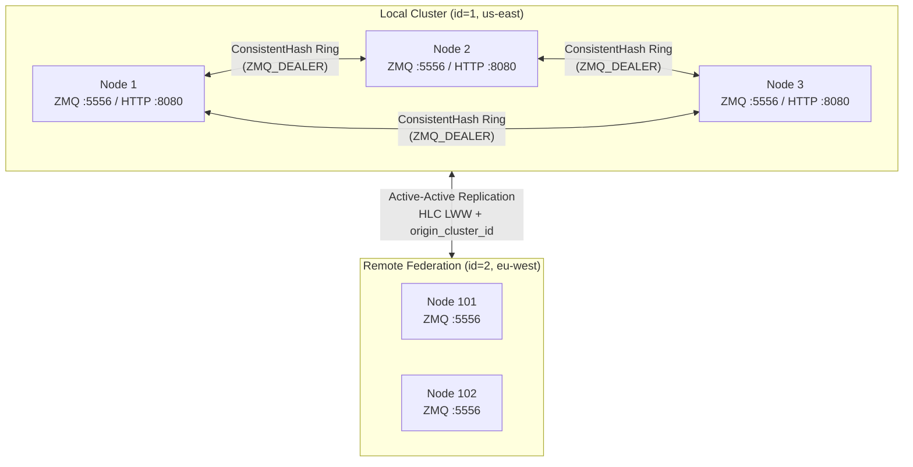
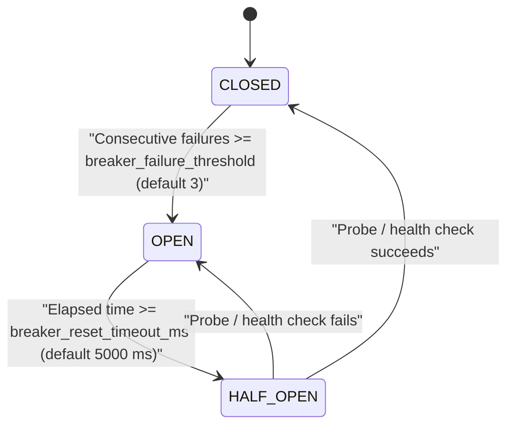

# Clustering, Federation & Active-Active Replication

`l3kvg` scales horizontally across nodes within a local cluster using **consistent hashing**, and across geographic regions/clusters using **asynchronous active-active replication** with **Hybrid Logical Clocks (HLC)** and **per-peer circuit breakers**.

---

## 1. Consistent-Hash Sharding (`FederationResolver`)

Defined in [FederationResolver.hpp](file:///home/darkfell/dev/l3kvg/include/L3KVG/FederationResolver.hpp):

* **Ownership Routing**: `FederationResolver::get_node_owner(vertex_id)` hashes the 64-bit `vertex_id` onto a `lite3::ConsistentHash` ring to determine which physical `NodeID` owns that vertex.
* **Local vs. Remote Fast Path**: `is_local(vertex_id)` checks whether the owner equals `local_node_id_`. Local vertices are served directly from `AdjacencyStore` / `l3kv::Engine` with zero network hops; remote vertices are transparently routed via `RemoteL3KVClient`.
* **Cluster Topology**: Each node has a `local_cluster_id` and `local_cluster_name`, plus zero or more remote `federations` registered with `{name, id, endpoints[]}`.

---

## 2. Sharded Edge Write Coordination (`EdgeCoordinator`)

Cross-node edge mutations (`atomic_put_edge`, `atomic_del_edge`) are coordinated by [EdgeCoordinator.hpp](file:///home/darkfell/dev/l3kvg/include/L3KVG/EdgeCoordinator.hpp):

* **Sharded Write Buffers**: Writes are partitioned across `edge_write_shards` (default `8`) mutex-protected batch shards.
* **Micro-Batch Flusher**: A dedicated background thread flushes pending batches every `edge_flush_interval_ms` (default `2 ms`), fulfilling `std::future<void>` promises once persisted and triggering the `broadcast_replication` callback for remote clusters.

---

## 3. Active-Active Replication & Conflict Resolution (`HLC`)

When `federations` are configured, local mutations are broadcast to remote clusters via `Engine::broadcast_replication(key, payload, origin_cluster_id)` ([Engine.hpp](file:///home/darkfell/dev/l3kvg/include/L3KVG/Engine.hpp#L74-L75)):

* **Deterministic Last-Writer-Wins (LWW)**: Every node and edge mutation carries an `HLCTimestamp` ([HLC.hpp](file:///home/darkfell/dev/l3kvg/include/L3KVG/HLC.hpp)) ordered lexicographically by `(wall_time, logical, node_id)`. If two clusters update the same key concurrently, the higher HLC wins deterministically without a distributed lock.
* **Replication Loop Prevention**: Incoming replicated writes carry `origin_cluster_id`. `Engine::replicate_key()` applies the mutation locally without re-broadcasting it back to the originating cluster.

---

## 4. Transport & Circuit Breakers (`RemoteL3KVClient`)

Defined in [RemoteL3KVClient.hpp](file:///home/darkfell/dev/l3kvg/include/L3KVG/RemoteL3KVClient.hpp) and [RemoteL3KVClient.cpp](file:///home/darkfell/dev/l3kvg/src/RemoteL3KVClient.cpp):

* **ZeroMQ `ZMQ_DEALER` Pool**: Each worker thread uses `thread_local` `ZMQ_DEALER` sockets bounded by `zmq_sndhwm` (default `1000` messages) and `fed_timeout_ms` (default `30000 ms`).
* **Per-Peer Circuit Breaker**: Protects local query threads from hanging on unreachable peers or partitioned WAN links:

* **Exceptions Surfaced to Callers**:
  * `CircuitBreakerOpenException`: Fast-fail thrown immediately while a peer's breaker is `OPEN` (no network wait).
  * `FederationTimeoutException`: Thrown when a remote RPC exceeds `fed_timeout_ms`.
* **Background Health Checks**: A background monitor probes peers every `health_check_interval_ms` (default `1000 ms`) to transition `OPEN` peers through `HALF_OPEN` back to `CLOSED` once connectivity is restored.
