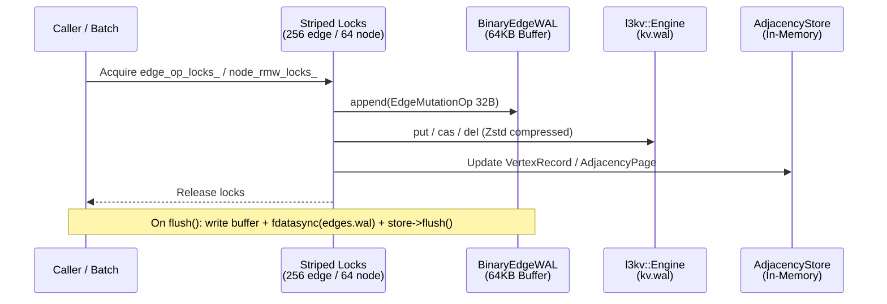
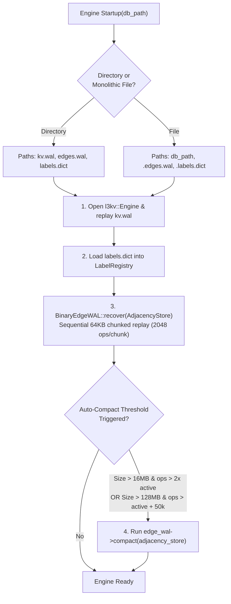

# Durability, WAL & Crash Recovery

`l3kvg` uses **two coordinated Write-Ahead Logs**—one for KV payloads/indexes (`kv.wal`) and one for binary graph edges (`edges.wal`)—plus a persisted label dictionary (`labels.dict`). Understanding how these files are written, flushed, recovered, and compacted is essential for capacity planning and incident recovery.

---

## 1. Write Path & Durability Guarantees

### `BinaryEdgeWAL` (`edges.wal`)
Defined in [BinaryEdgeWAL.hpp](file:///home/darkfell/dev/l3kvg/include/L3KVG/BinaryEdgeWAL.hpp) and [BinaryEdgeWAL.cpp](file:///home/darkfell/dev/l3kvg/src/BinaryEdgeWAL.cpp):

* **Fixed 32-Byte Record (`EdgeMutationOp`)**: Every edge insertion or deletion is serialized as a 32-byte, 8-byte-aligned struct containing `src_id`, `dst_id`, `hlc_timestamp`, `label_id`, `flags` (`OP_DELETE`, `FLAG_ACTIVE`), and `weight`.
* **64 KB User-Space Buffering**: Writes accumulate in a `65,536`-byte (`64 KB`) buffer (`buffer_`) before issuing OS writes. Large batches ($\ge 64\text{ KB}$) bypass the buffer and write directly.
* **Explicit `fdatasync` / `fsync`**: Calling `Engine::flush()` (or `BinaryEdgeWAL::flush()`) flushes `buffer_`, invokes POSIX `fdatasync()` (or `fsync()` on fallback) on `edges.wal`, and calls `store_->wait_all_shards(); store_->flush();` on `l3kv::Engine`.

### `MutationBatch` (Zero-Copy Atomic Batching)
Defined in [MutationBatch.hpp](file:///home/darkfell/dev/l3kvg/include/L3KVG/MutationBatch.hpp), `MutationBatch` serializes heterogeneous operations (`PutRaw`, `CasRaw` with `expected_hash` and `ttl_ms`, `PutNode`, `AddEdge`, `DelRaw`, `DelNode`, `DelEdge`, `IncNodeInt`) into a single `lite3cpp::Buffer` applied atomically via `Engine::apply_batch()`.

---

## 2. Startup & Crash Recovery Sequence

When `l3kvg::Engine` starts against an existing `db_path` ([Engine.cpp](file:///home/darkfell/dev/l3kvg/src/Engine.cpp#L207-L240)):

* **64 KB Chunked Replay**: `BinaryEdgeWAL::recover()` reads `edges.wal` sequentially in `65,536`-byte chunks (2,048 `EdgeMutationOp` records per chunk) directly into `AdjacencyStore`, rebuilding `VertexRecord`s and `AdjacencyPage`s at multi-GB/s memory bandwidth without JSON/BSON parsing.
* **Automatic Startup Compaction**: If `edges.wal` has accumulated heavy tombstone/update churn, `Engine` automatically compacts it on startup when either condition holds:
  1. `file_size > 16 MB` **and** `recovered_edges > 2 * active_edges`, or
  2. `file_size > 128 MB` **and** `recovered_edges > active_edges + 50,000`.

---

## 3. Online Compaction (`Engine::compact_wal()`)

Administrators or host applications can trigger manual compaction at runtime via `Engine::compact_wal()` ([Engine.cpp](file:///home/darkfell/dev/l3kvg/src/Engine.cpp#L720-L730)), which executes three steps:
1. `store_->compact_wal()` — Compacts `kv.wal` in `l3kv::Engine`.
2. `edge_wal_->compact(adjacency_store_)` — Rewrites `edges.wal` to a temporary file containing only the live active edges currently in `AdjacencyStore`, `fsync`s the temporary file and parent directory, and atomically replaces `edges.wal`.
3. `label_registry_.persist()` — Flushes the label dictionary to `labels.dict`.

---

## 4. Backup & Snapshot Recommendations

Because `l3kvg` splits state across **three** files (`kv.wal`, `edges.wal`, and `labels.dict`), always back up all three together:
1. **Consistent Cold Backup**: Stop the process (or quiesce writes and call `Engine::flush()`), then copy `kv.wal`, `edges.wal`, and `labels.dict` (or `<db_path>`, `<db_path>.edges.wal`, `<db_path>.labels.dict`).
2. **Pre-Backup Compaction**: Running `compact_wal()` before archiving significantly reduces snapshot size when workloads perform frequent edge deletions or weight updates.
3. **Never Omit `labels.dict`**: `edges.wal` stores 16-bit `label_id` integers; restoring `edges.wal` without the matching `labels.dict` will leave edge labels unresolvable.
