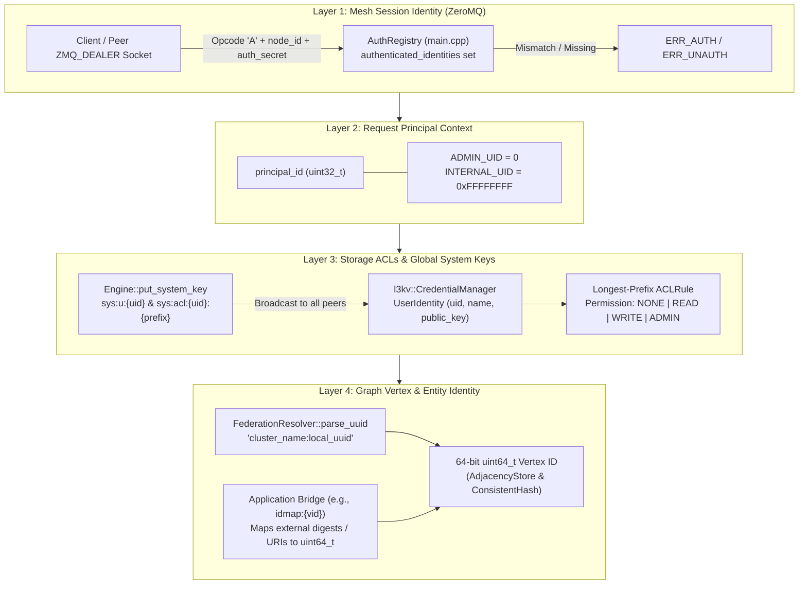
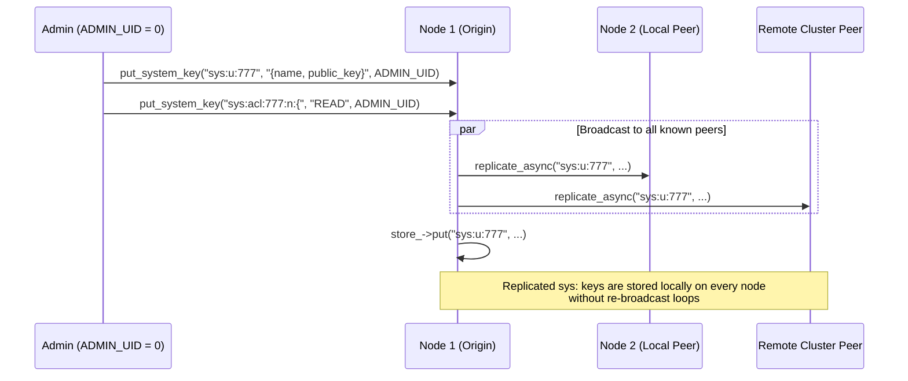

# Identity Management, Principals & Access Control

Identity in `l3kvg` spans **four distinct layers**: (1) **Node/Session Authentication** between ZeroMQ peers, (2) **Principal Identity (`uint32_t principal_id`)** propagated on every request, (3) **Storage-Level Prefix ACLs** enforced by `l3kv::CredentialManager` and `sys:` replication, and (4) **Graph Vertex & External Entity Identity** (`uint64_t` vertex IDs, `cluster:uuid` parsing, and `idmap:` bridging).

---

## 1. The Four Identity Layers

---

## 2. Mesh Session Authentication (`auth_secret` & `AuthRegistry`)

In standalone server deployments ([main.cpp](file:///home/darkfell/dev/l3kvg/src/server/main.cpp#L189-L222)), ZeroMQ `ROUTER` sockets enforce transport-level shared-secret authentication whenever `auth_secret` is non-empty in `config.json`:

1. **Handshake (`opcode == "A"`)**: A connecting `RemoteL3KVClient` sends `node_id` and `auth_secret`.
   * If `secret == cfg.auth_secret`, the server records the ZeroMQ socket identity in `AuthRegistry::authenticated_identities` and replies `"OK"`.
   * If the secret does not match, the server replies `"ERR_AUTH"`.
2. **Subsequent Requests**: Every non-`"A"` frame checks `auth_registry.authenticated_identities` under a `std::shared_lock`. Unauthenticated sockets are rejected immediately with `"ERR_UNAUTH"`.

> [!IMPORTANT]
> **All nodes in a cluster or federation must share the same `auth_secret`** when authentication is enabled. A mismatched `auth_secret` on one peer produces `"ERR_AUTH"` responses, which increment `breaker_failure_threshold` and trip that peer's circuit breaker to `OPEN`.

---

## 3. Principal Identity (`principal_id`) & Built-In UIDs

Every graph operation carries a 32-bit `uint32_t principal_id`:
* **C++ Embedded APIs**: `Query::set_principal_id(uid)`, `Engine::fetch_nodes(ids, principal_id)`, `Engine::apply_batch(buf, principal_id)`, `Engine::scan_kv_prefix(..., principal_id)`, and `RemoteL3KVClient` RPC methods all accept `principal_id` (defaulting to `INTERNAL_UID`).
* **Server Fallback**: `Settings::default_principal_id` ([Settings.hpp](file:///home/darkfell/dev/l3kvg/include/L3KVG/Settings.hpp#L15)) defaults to `INTERNAL_UID`.

### Built-In Privileged UIDs

| Constant | Value | Behavior |
| :--- | :---: | :--- |
| `ADMIN_UID` | `0` | Bypasses `CredentialManager` ACLs. **Required** by `Engine::put_system_key()` to write `sys:` keys. |
| `INTERNAL_UID` | `0xFFFFFFFF` | Bypasses `CredentialManager` ACLs for trusted in-process/embedded engine callers. **Rejected** by `put_system_key()` (only `ADMIN_UID = 0` may modify system metadata). |

---

## 4. Storage-Level ACLs (`l3kv::CredentialManager`)

Authorization is enforced at the storage layer ([credential_manager.hpp](file:///home/darkfell/dev/L3KV/src/engine/credential_manager.hpp)) and in `l3kvg_server` via `has_read_acl` / `has_write_acl` ([main.cpp](file:///home/darkfell/dev/l3kvg/src/server/main.cpp#L73-L84)):

### User Registration & Permissions
* **Identity Record**: `UserIdentity { uint32_t uid; std::string name; std::string public_key; }` (indexed by `uid` and `public_key`).
* **Permission Bitmask (`l3kv::Permission`)**:
  * `NONE` (`0`)
  * `READ` (`1 << 0`)
  * `WRITE` (`1 << 1`)
  * `ADMIN` (`1 << 2`)
* **Longest-Prefix Matching**: `set_acl(uid, prefix, perm)` sorts a user's `ACLRule` list by `prefix.length()` descending. `check_permission(uid, key)` returns the permission of the **longest matching prefix** (or `"*"` wildcard).

### Multi-Tenant & Regional Sandboxing Examples
Because `l3kvg` keys follow structured prefixes (`n:{id}`, `pidxs:{scope}:...`, `sys:...`), administrators can isolate tenants or geographic regions using prefix ACLs:
* **Read-only access to all nodes**: `set_acl(500, "n:{", Permission::READ)`
* **Read/Write scoped to a single node key**: `set_acl(901, "n:{0000000000006099}", Permission::READ | Permission::WRITE)`
* **Cluster-scoped write isolation**: `set_acl(2, "n:{cluster2:", Permission::READ | Permission::WRITE)`

---

## 5. Global Identity Replication (`sys:u:` & `sys:acl:`)

In a multi-node or federated mesh, a principal created on one node must be recognized on every other node during cross-shard or cross-region `Query` hops without requiring remote auth round-trips:

* **`Engine::put_system_key(key, payload, principal_id)`** ([Engine.cpp](file:///home/darkfell/dev/l3kvg/src/Engine.cpp#L634-L653)):
  1. Verifies `principal_id == ADMIN_UID` (`0`); otherwise throws `"Unauthorized: Only ADMIN can modify system metadata"`.
  2. Broadcasts the key to **all known peers** (`resolver_.get_all_node_ids()`) asynchronously via `remote_client_->replicate_async()`.
  3. Persists the key locally in `l3kv::Engine`.
* **System Key Conventions**:
  * `sys:u:<uid>` — Serialized user identity JSON (`{"name": "...", "public_key": "..."}`).
  * `sys:acl:<uid>:<prefix>` — Permission string (e.g., `"READ"`, `"READ|WRITE"`, `"ADMIN"`).

---

## 6. Graph Vertex & External Entity Identity

`l3kvg`'s hot topology layer (`AdjacencyStore`) and consistent-hash ring (`FederationResolver`) operate exclusively on **64-bit unsigned integer IDs (`uint64_t`)**:

1. **Cluster-Qualified UUIDs (`FederationResolver::parse_uuid`)**:
   * Defined in [FederationResolver.cpp](file:///home/darkfell/dev/l3kvg/src/FederationResolver.cpp#L118-L152).
   * Accepts `"cluster_name:local_uuid"` or an unqualified `"local_uuid"`.
   * Resolves `cluster_name` against registered `federations` (throwing if an unknown cluster prefix is given when federations are registered) and maps the identifier to a `uint64_t` vertex ID.
2. **External String-to-`uint64_t` Bridging (`idmap:` Pattern)**:
   * Host applications with arbitrary string identifiers (e.g., OIDC `sub` claims, POSIX `uid`/`gid`, S3 bucket/object paths, or SHA-256 content digests) should maintain an explicit bidirectional mapping in `l3kv` (such as `idmap:{vid}` storing the canonical external key alongside hashed `uint64_t` vertex IDs) to prevent hash-collision ambiguity and enable deterministic reverse lookups.

---

## 7. Administrator Checklist & Common Pitfalls

* **Separate `ADMIN_UID` vs. `INTERNAL_UID`**: Use `ADMIN_UID (0)` for provisioning `sys:u:` / `sys:acl:` keys via `put_system_key()`, and `INTERNAL_UID (0xFFFFFFFF)` only for trusted internal engine calls.
* **Keep `auth_secret` Synchronized**: Rotating `auth_secret` on one node without updating peers will trip circuit breakers across the mesh (`ERR_AUTH`).
* **Remember Longest-Prefix Precedence**: A more specific prefix rule (e.g., `n:{restricted:`) overrides a shorter rule (e.g., `n:{` or `*`), even if the shorter rule grants broader permissions.
* **Back Up `kv.wal` for Identity State**: All `sys:u:` and `sys:acl:` records live in `kv.wal`; backing up `edges.wal` without `kv.wal` loses all persisted user and ACL definitions.
