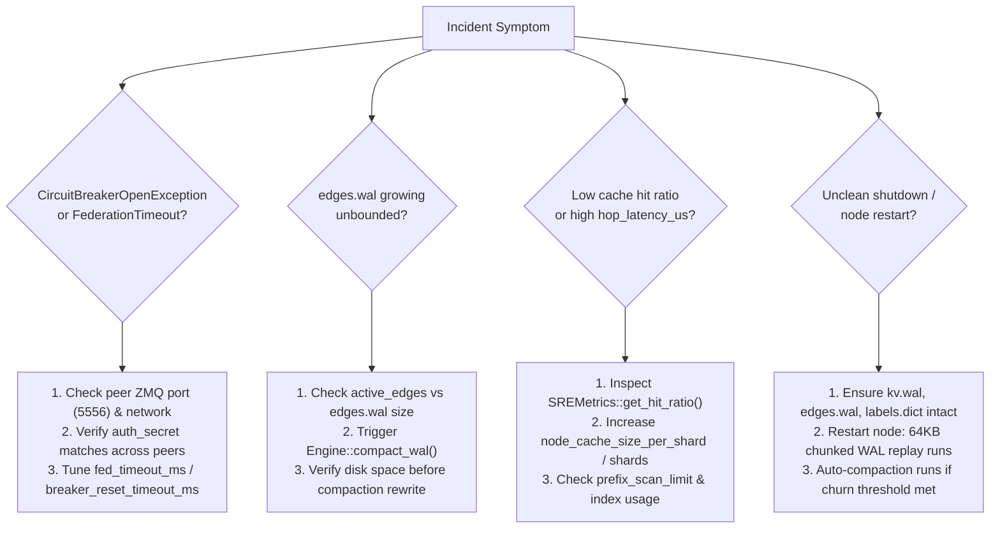

# Security, Observability & Operational Runbooks

---

## 1. Security Model & Access Control

`l3kvg` enforces authentication and fine-grained key/graph ACLs on its ZeroMQ RPC plane ([main.cpp](file:///home/darkfell/dev/l3kvg/src/server/main.cpp#L73-L84)) via `l3kv::CredentialManager`:

* **ZeroMQ Transport Auth (`auth_secret`)**: When `auth_secret` is configured, incoming ZeroMQ client identities must authenticate before issuing graph reads or mutations; unauthenticated requests receive `ERR_AUTH` / `ERR_UNAUTH`.
* **Per-Key ACLs (`l3kv::Permission`)**:
  * `READ` / `WRITE` / `ADMIN` permissions are checked against the caller's `principal_id` (`uid`).
  * **Privileged Built-in UIDs** ([Settings.hpp](file:///home/darkfell/dev/l3kvg/include/L3KVG/Settings.hpp#L10-L11)):
    * `ADMIN_UID = 0` — Superuser bypasses key ACL checks (used for system keys via `put_system_key`).
    * `INTERNAL_UID = 0xFFFFFFFF` — Internal engine/host bypass for trusted embedded callers.
* **HTTP Surface Warning**: In [main.cpp](file:///home/darkfell/dev/l3kvg/src/server/main.cpp#L916), `http_port` (`8080`) binds `0.0.0.0` and serves `GET /api/health` without TLS or authentication. As noted in [API.md](file:///home/darkfell/dev/l3kvg/API.md#L44-L46), always place HTTP endpoints behind a firewall or TLS-terminating reverse proxy.

> See [Identity Management, Principals & Access Control](identity_management.md) for the full 4-layer identity model (`auth_secret`, `principal_id`, `CredentialManager` longest-prefix ACLs, `sys:` replication, and vertex ID resolution).

---

## 2. Observability & SRE Metrics

`l3kvg::Engine::get_metrics()` exposes `SREMetrics` ([Engine.hpp](file:///home/darkfell/dev/l3kvg/include/L3KVG/Engine.hpp#L36-L47)) using lock-free `std::atomic<uint64_t>` counters:

| Metric / Accessor | Type | Meaning |
| :--- | :---: | :--- |
| `hop_latency_us` | `atomic<uint64_t>` | Observed graph hop traversal latency (microseconds). |
| `serialization_time_us` | `atomic<uint64_t>` | Time spent serializing/deserializing `Node` payloads (microseconds). |
| `cache_hits` / `cache_misses` | `atomic<uint64_t>` | Sharded LRU `Node` cache hit/miss counters. |
| `get_hit_ratio()` | `double` | `cache_hits / (cache_hits + cache_misses)` (`0.0` if no lookups). |
| `get_edge_wal()->file_size()` | `uint64_t` | Current byte size of `edges.wal`. |
| `get_label_registry().size()` | `size_t` | Number of interned edge labels (max `65,535`). |

For standalone deployments, `GET /api/health` provides liveness probing on `http_port`.

---

## 3. Operational Troubleshooting & Runbooks

### Runbook A: `CircuitBreakerOpenException` or `FederationTimeoutException`
1. **Verify Peer Liveness**: Check `GET http://<peer>:<http_port>/api/health` and TCP reachability to `<peer>:<zmq_port>` (default `5556`).
2. **Verify `auth_secret`**: A mismatched `auth_secret` causes `ERR_AUTH` failures, which trip `breaker_failure_threshold` (`3`).
3. **Check WAN Latency**: If cross-region RTT causes intermittent timeouts, increase `fed_timeout_ms` (default `30000 ms`) or `breaker_failure_threshold` in `Settings`.
4. **Recovery**: Once the peer is reachable, the background health check (`health_check_interval_ms = 1000 ms`) transitions the breaker `OPEN -> HALF_OPEN -> CLOSED` after `breaker_reset_timeout_ms` (`5000 ms`).

### Runbook B: `edges.wal` Disk Bloat
1. **Cause**: Frequent edge deletions or weight updates append 32-byte `EdgeMutationOp` records without overwriting in place.
2. **Immediate Action**: Call `Engine::compact_wal()` (or restart the node, which auto-compacts if `edges.wal > 16 MB` with `> 2x` dead ops, or `> 128 MB` with `> 50k` dead ops).
3. **Disk Headroom**: `BinaryEdgeWAL::compact()` writes a temporary compacted file before atomically replacing `edges.wal`, so ensure free disk space is at least equal to the live edge dataset size.

### Runbook C: Low Node Cache Hit Ratio (`get_hit_ratio()`)
1. **Cause**: Working set of hot `Node` property documents exceeds `node_cache_shards * node_cache_size_per_shard` (default `16,000` nodes).
2. **Action**: Increase `node_cache_size_per_shard` (and `node_cache_shards` if lock contention is observed on high-core hosts).
3. **Index Check**: Confirm `fallback_to_full_scan_on_index_miss` is `false` so missed property lookups do not trigger full KV scans that evict hot cache entries.

### Runbook D: Unclean Shutdown Recovery
1. **Automatic Replay**: On restart, `l3kv::Engine` replays `kv.wal`, `LabelRegistry` loads `labels.dict`, and `BinaryEdgeWAL::recover()` replays `edges.wal` in 64 KB chunks.
2. **Validation**: Confirm startup logs report no exceptions and `GET /api/health` returns `200 OK`.
3. **Label Dictionary Integrity**: Never delete `labels.dict` (or `.labels.dict`) independently of `edges.wal`, as edge records reference 16-bit label IDs stored in that dictionary.
