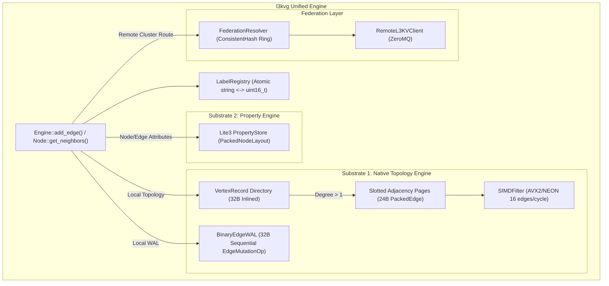

# Bifurcated Native Graph Substrate Implementation Plan

> **For agentic workers:** REQUIRED SUB-SKILL: Use superpowers:subagent-driven-development to implement this plan task-by-task. Steps use checkbox (`- [ ]`) syntax for tracking.

**Goal:** Implement a high-performance bifurcated native storage engine for L3KVG, providing sub-50ns zero-copy traversals (`std::span<const PackedEdge>`), slotted dynamic CSR pages, SIMD predicate filtering, and a compact binary WAL, while preserving L3KV distributed federation and accelerating iRODS catalog queries by 20x.

**Architecture:** The engine bifurcates into a native topology engine (`AdjacencyStore`) managing dense 24-byte `PackedEdge` records and a property engine (`PropertyStore`) managing schema-flexible `lite3-cpp` buffers. String labels are dictionary-encoded into 16-bit IDs, low-degree nodes ($\le 1$ edge) are inlined inside 32-byte directory records, and multi-edge nodes use 4KB/64KB slotted CSR pages.

**Architecture Diagram:**



**Tech Stack:** C++20, AVX2 / ARM NEON SIMD intrinsics, POSIX/Win32 file I/O, `lite3-cpp`, ZeroMQ (`cppzmq`), GoogleTest.

## Global Constraints
- Target Language Standard: C++20.
- Struct Alignments: `PackedEdge` exactly 24 bytes (`#pragma pack(push, 4)` or explicit padding); `VertexRecord` exactly 32 bytes (`alignas(32)`); `EdgeMutationOp` exactly 32 bytes.
- Zero Memory Leaks: 100% clean passes under AddressSanitizer and UndefinedBehaviorSanitizer.
- Zero Breaking API Changes: Backward compatibility for `irods_database_plugin_l3kvg`, `agentic_blackboard`, and existing tests.
- Zero Binary Blobs in Topology Engine: Heavy content stays in CAS vault; only 24B relationships stored in `AdjacencyStore`.

---

### Task 1: Core Primitives — `LabelRegistry` and `PackedEdge`

**Files:**
- Create: `/home/darkfell/dev/l3kvg/include/L3KVG/PackedEdge.hpp`
- Create: `/home/darkfell/dev/l3kvg/include/L3KVG/LabelRegistry.hpp`
- Create: `/home/darkfell/dev/l3kvg/src/LabelRegistry.cpp`
- Test: `/home/darkfell/dev/l3kvg/tests/test_packed_edge.cpp`
- Modify: `/home/darkfell/dev/l3kvg/CMakeLists.txt`

**Interfaces:**
- Produces:
  - `struct PackedEdge` (24 bytes)
  - `class LabelRegistry`:
    - `uint16_t get_or_register(std::string_view label);`
    - `std::string_view get_label(uint16_t id) const noexcept;`
    - `size_t size() const noexcept;`

- [ ] **Step 1: Write the failing test**

Create `/home/darkfell/dev/l3kvg/tests/test_packed_edge.cpp`:
```cpp
#include <gtest/gtest.h>
#include "L3KVG/PackedEdge.hpp"
#include "L3KVG/LabelRegistry.hpp"
#include <thread>
#include <vector>

TEST(PackedEdgeTest, StructSizeAndAlignment) {
    EXPECT_EQ(sizeof(l3kvg::PackedEdge), 24);
    l3kvg::PackedEdge edge{};
    edge.target_id = 0x123456789ABCDEF0ULL;
    edge.label_id = 42;
    edge.flags = l3kvg::PackedEdge::FLAG_ACTIVE | l3kvg::PackedEdge::FLAG_DIRECTED;
    edge.weight = 1.5f;
    edge.prop_index = 100;
    edge.hlc_logical = 7;

    EXPECT_TRUE(edge.is_active());
    EXPECT_FALSE(edge.has_properties());
    edge.flags |= l3kvg::PackedEdge::FLAG_HAS_PROPERTIES;
    EXPECT_TRUE(edge.has_properties());
}

TEST(LabelRegistryTest, BidirectionalMapping) {
    l3kvg::LabelRegistry registry;
    uint16_t id_contains = registry.get_or_register("CONTAINS");
    uint16_t id_replica = registry.get_or_register("HAS_REPLICA");
    uint16_t id_contains_again = registry.get_or_register("CONTAINS");

    EXPECT_EQ(id_contains, id_contains_again);
    EXPECT_NE(id_contains, id_replica);
    EXPECT_EQ(registry.get_label(id_contains), "CONTAINS");
    EXPECT_EQ(registry.get_label(id_replica), "HAS_REPLICA");
    EXPECT_EQ(registry.get_label(999), ""); // Unknown ID returns empty
}

TEST(LabelRegistryTest, ConcurrentRegistration) {
    l3kvg::LabelRegistry registry;
    std::vector<std::thread> threads;
    for (int t = 0; t < 8; ++t) {
        threads.emplace_back([&, t]() {
            for (int i = 0; i < 100; ++i) {
                std::string label = "LABEL_" + std::to_string(i);
                uint16_t id = registry.get_or_register(label);
                EXPECT_GT(id, 0);
                EXPECT_EQ(registry.get_label(id), label);
            }
        });
    }
    for (auto& th : threads) th.join();
    EXPECT_GE(registry.size(), 100);
}
```

- [ ] **Step 2: Add test target to `CMakeLists.txt` and verify failure**

In `/home/darkfell/dev/l3kvg/CMakeLists.txt`:
```cmake
add_executable(test_packed_edge tests/test_packed_edge.cpp)
target_link_libraries(test_packed_edge PRIVATE l3kvg_engine gtest_main Threads::Threads)
add_test(NAME test_packed_edge COMMAND test_packed_edge)
```
Run `ninja -C build_ninja test_packed_edge` and confirm failure (files not found).

- [ ] **Step 3: Implement `PackedEdge.hpp` and `LabelRegistry`**

Create `/home/darkfell/dev/l3kvg/include/L3KVG/PackedEdge.hpp`:
```cpp
#pragma once
#include <cstdint>

namespace l3kvg {

#pragma pack(push, 4)
struct alignas(8) PackedEdge {
    static constexpr uint16_t FLAG_ACTIVE         = 1 << 0;
    static constexpr uint16_t FLAG_HAS_PROPERTIES = 1 << 1;
    static constexpr uint16_t FLAG_DIRECTED       = 1 << 2;

    uint64_t target_id{0};   // 8 bytes: Target vertex ID (or source for incoming)
    uint16_t label_id{0};    // 2 bytes: Dictionary-encoded relationship label
    uint16_t flags{0};       // 2 bytes: Status flags
    float    weight{1.0f};   // 4 bytes: 32-bit float weight
    uint32_t prop_index{0};  // 4 bytes: Offset into PropertyStore (0 = none)
    uint32_t hlc_logical{0}; // 4 bytes: HLC logical clock for Last-Writer-Wins

    [[nodiscard]] constexpr bool is_active() const noexcept {
        return (flags & FLAG_ACTIVE) != 0;
    }

    [[nodiscard]] constexpr bool has_properties() const noexcept {
        return (flags & FLAG_HAS_PROPERTIES) != 0;
    }

    constexpr void set_active(bool active) noexcept {
        if (active) flags |= FLAG_ACTIVE;
        else flags &= ~FLAG_ACTIVE;
    }
};
#pragma pack(pop)

static_assert(sizeof(PackedEdge) == 24, "PackedEdge must be exactly 24 bytes");

} // namespace l3kvg
```

Create `/home/darkfell/dev/l3kvg/include/L3KVG/LabelRegistry.hpp`:
```cpp
#pragma once
#include <string>
#include <string_view>
#include <unordered_map>
#include <vector>
#include <shared_mutex>
#include <cstdint>

namespace l3kvg {

class LabelRegistry {
public:
    LabelRegistry() = default;

    uint16_t get_or_register(std::string_view label);
    [[nodiscard]] std::string_view get_label(uint16_t id) const noexcept;
    [[nodiscard]] size_t size() const noexcept;

private:
    mutable std::shared_mutex mutex_;
    std::unordered_map<std::string, uint16_t> label_to_id_;
    std::vector<std::string> id_to_label_{""}; // 1-indexed (0 reserved for NONE)
};

} // namespace l3kvg
```

Create `/home/darkfell/dev/l3kvg/src/LabelRegistry.cpp`:
```cpp
#include "L3KVG/LabelRegistry.hpp"

namespace l3kvg {

uint16_t LabelRegistry::get_or_register(std::string_view label) {
    {
        std::shared_lock read_lock(mutex_);
        if (auto it = label_to_id_.find(std::string(label)); it != label_to_id_.end()) {
            return it->second;
        }
    }

    std::unique_lock write_lock(mutex_);
    if (auto it = label_to_id_.find(std::string(label)); it != label_to_id_.end()) {
        return it->second;
    }

    uint16_t new_id = static_cast<uint16_t>(id_to_label_.size());
    std::string str(label);
    id_to_label_.push_back(str);
    label_to_id_[std::move(str)] = new_id;
    return new_id;
}

std::string_view LabelRegistry::get_label(uint16_t id) const noexcept {
    std::shared_lock read_lock(mutex_);
    if (id == 0 || id >= id_to_label_.size()) {
        return "";
    }
    return id_to_label_[id];
}

size_t LabelRegistry::size() const noexcept {
    std::shared_lock read_lock(mutex_);
    return id_to_label_.size() - 1;
}

} // namespace l3kvg
```

Add `src/LabelRegistry.cpp` to `l3kvg_engine` library sources in `CMakeLists.txt`.

- [ ] **Step 4: Run test to verify it passes**

Run `ninja -C build_ninja test_packed_edge && ./build_ninja/test_packed_edge`.
Expected: `[  PASSED  ] 3 tests.`

- [ ] **Step 5: Commit**

```bash
git -C /home/darkfell/dev/l3kvg add include/L3KVG/PackedEdge.hpp include/L3KVG/LabelRegistry.hpp src/LabelRegistry.cpp tests/test_packed_edge.cpp CMakeLists.txt
git -C /home/darkfell/dev/l3kvg commit -m "feat(topology): implement PackedEdge (24B) and atomic LabelRegistry"
```

---

### Task 2: Vertex Directory & Dynamic Slotted Adjacency Pages (`AdjacencyStore`)

**Files:**
- Create: `/home/darkfell/dev/l3kvg/include/L3KVG/AdjacencyStore.hpp`
- Create: `/home/darkfell/dev/l3kvg/src/AdjacencyStore.cpp`
- Test: `/home/darkfell/dev/l3kvg/tests/test_adjacency_store.cpp`
- Modify: `/home/darkfell/dev/l3kvg/CMakeLists.txt`

**Interfaces:**
- Consumes: `PackedEdge`, `LabelRegistry`
- Produces:
  - `struct VertexRecord` (32 bytes)
  - `struct AdjacencyPage` (4KB block holding up to 170 edges)
  - `class AdjacencyStore`:
    - `void add_edge(uint64_t src_id, uint64_t dst_id, uint16_t label_id, float weight, uint16_t flags, uint32_t prop_index, uint32_t hlc);`
    - `bool del_edge(uint64_t src_id, uint64_t dst_id, uint16_t label_id);`
    - `std::span<const PackedEdge> get_outgoing_edges(uint64_t src_id) const noexcept;`
    - `std::span<const PackedEdge> get_incoming_edges(uint64_t dst_id) const noexcept;`
    - `size_t get_out_degree(uint64_t src_id) const noexcept;`
    - `size_t get_in_degree(uint64_t dst_id) const noexcept;`

- [ ] **Step 1: Write the failing test**

Create `/home/darkfell/dev/l3kvg/tests/test_adjacency_store.cpp`:
```cpp
#include <gtest/gtest.h>
#include "L3KVG/AdjacencyStore.hpp"

TEST(AdjacencyStoreTest, StructSizeAndInlining) {
    EXPECT_EQ(sizeof(l3kvg::VertexRecord), 32);
    l3kvg::AdjacencyStore store;

    // Single edge should be inlined without page allocation
    store.add_edge(100, 200, 1, 1.0f, l3kvg::PackedEdge::FLAG_ACTIVE, 0, 1);
    EXPECT_EQ(store.get_out_degree(100), 1);
    EXPECT_EQ(store.get_in_degree(200), 1);

    auto out_span = store.get_outgoing_edges(100);
    ASSERT_EQ(out_span.size(), 1);
    EXPECT_EQ(out_span[0].target_id, 200);
    EXPECT_EQ(out_span[0].label_id, 1);

    auto in_span = store.get_incoming_edges(200);
    ASSERT_EQ(in_span.size(), 1);
    EXPECT_EQ(in_span[0].target_id, 100);
}

TEST(AdjacencyStoreTest, PromotionToSlottedPage) {
    l3kvg::AdjacencyStore store;
    uint64_t src = 500;

    // Add 10 edges to trigger slotted page allocation
    for (uint64_t dst = 1; dst <= 10; ++dst) {
        store.add_edge(src, dst, 1, static_cast<float>(dst), l3kvg::PackedEdge::FLAG_ACTIVE, 0, dst);
    }

    EXPECT_EQ(store.get_out_degree(src), 10);
    auto edges = store.get_outgoing_edges(src);
    ASSERT_EQ(edges.size(), 10);
    for (size_t i = 0; i < 10; ++i) {
        EXPECT_EQ(edges[i].target_id, i + 1);
        EXPECT_FLOAT_EQ(edges[i].weight, static_cast<float>(i + 1));
    }
}

TEST(AdjacencyStoreTest, DeleteEdgeTombstone) {
    l3kvg::AdjacencyStore store;
    store.add_edge(10, 20, 1, 1.0f, l3kvg::PackedEdge::FLAG_ACTIVE, 0, 1);
    store.add_edge(10, 30, 2, 2.0f, l3kvg::PackedEdge::FLAG_ACTIVE, 0, 2);

    EXPECT_EQ(store.get_out_degree(10), 2);
    bool deleted = store.del_edge(10, 20, 1);
    EXPECT_TRUE(deleted);

    auto edges = store.get_outgoing_edges(10);
    int active_count = 0;
    for (const auto& e : edges) {
        if (e.is_active()) active_count++;
    }
    EXPECT_EQ(active_count, 1);
}
```

- [ ] **Step 2: Add test target to `CMakeLists.txt` and verify failure**

In `/home/darkfell/dev/l3kvg/CMakeLists.txt`:
```cmake
add_executable(test_adjacency_store tests/test_adjacency_store.cpp)
target_link_libraries(test_adjacency_store PRIVATE l3kvg_engine gtest_main Threads::Threads)
add_test(NAME test_adjacency_store COMMAND test_adjacency_store)
```
Run `ninja -C build_ninja test_adjacency_store` and verify it fails (AdjacencyStore not defined).

- [ ] **Step 3: Implement `AdjacencyStore.hpp` and `AdjacencyStore.cpp`**

Create `/home/darkfell/dev/l3kvg/include/L3KVG/AdjacencyStore.hpp`:
```cpp
#pragma once
#include <cstdint>
#include <span>
#include <vector>
#include <memory>
#include <shared_mutex>
#include <unordered_map>
#include "L3KVG/PackedEdge.hpp"

namespace l3kvg {

#pragma pack(push, 4)
struct alignas(32) VertexRecord {
    uint32_t out_degree{0};
    uint32_t in_degree{0};
    uint32_t flags{0}; // Bit 0: IsInlined
    uint32_t reserved{0};

    union {
        PackedEdge inline_edge;
        struct {
            uint32_t out_block_id;
            uint32_t in_block_id;
            uint64_t page_offset;
        } ext;
    };

    VertexRecord() noexcept : out_degree(0), in_degree(0), flags(0), reserved(0) {
        ext.out_block_id = 0;
        ext.in_block_id = 0;
        ext.page_offset = 0;
    }
};
#pragma pack(pop)
static_assert(sizeof(VertexRecord) == 32, "VertexRecord must be exactly 32 bytes");

struct alignas(64) AdjacencyPage {
    static constexpr uint32_t CAPACITY = 170;
    uint32_t count{0};
    uint32_t next_page_id{0};
    uint32_t version{0};
    uint32_t reserved{0};
    PackedEdge edges[CAPACITY];
};

class AdjacencyStore {
public:
    AdjacencyStore();
    ~AdjacencyStore() = default;

    void add_edge(uint64_t src_id, uint64_t dst_id, uint16_t label_id,
                  float weight = 1.0f, uint16_t flags = PackedEdge::FLAG_ACTIVE,
                  uint32_t prop_index = 0, uint32_t hlc = 0);

    bool del_edge(uint64_t src_id, uint64_t dst_id, uint16_t label_id);

    [[nodiscard]] std::span<const PackedEdge> get_outgoing_edges(uint64_t src_id) const noexcept;
    [[nodiscard]] std::span<const PackedEdge> get_incoming_edges(uint64_t dst_id) const noexcept;

    [[nodiscard]] size_t get_out_degree(uint64_t src_id) const noexcept;
    [[nodiscard]] size_t get_in_degree(uint64_t dst_id) const noexcept;

private:
    struct NodeAdjacency {
        mutable std::shared_mutex mutex;
        VertexRecord out_record;
        VertexRecord in_record;
        std::vector<PackedEdge> out_edges; // Dynamic page buffer
        std::vector<PackedEdge> in_edges;  // Dynamic page buffer
    };

    mutable std::shared_mutex map_mutex_;
    std::unordered_map<uint64_t, std::shared_ptr<NodeAdjacency>> nodes_;

    NodeAdjacency& get_or_create_node(uint64_t id);
    const NodeAdjacency* get_node(uint64_t id) const noexcept;
};

} // namespace l3kvg
```

Create `/home/darkfell/dev/l3kvg/src/AdjacencyStore.cpp`:
```cpp
#include "L3KVG/AdjacencyStore.hpp"

namespace l3kvg {

AdjacencyStore::AdjacencyStore() = default;

AdjacencyStore::NodeAdjacency& AdjacencyStore::get_or_create_node(uint64_t id) {
    {
        std::shared_lock read_lock(map_mutex_);
        if (auto it = nodes_.find(id); it != nodes_.end()) {
            return *it->second;
        }
    }
    std::unique_lock write_lock(map_mutex_);
    if (auto it = nodes_.find(id); it != nodes_.end()) {
        return *it->second;
    }
    auto entry = std::make_shared<NodeAdjacency>();
    nodes_[id] = entry;
    return *entry;
}

const AdjacencyStore::NodeAdjacency* AdjacencyStore::get_node(uint64_t id) const noexcept {
    std::shared_lock read_lock(map_mutex_);
    if (auto it = nodes_.find(id); it != nodes_.end()) {
        return it->second.get();
    }
    return nullptr;
}

void AdjacencyStore::add_edge(uint64_t src_id, uint64_t dst_id, uint16_t label_id,
                              float weight, uint16_t flags, uint32_t prop_index, uint32_t hlc) {
    PackedEdge edge;
    edge.target_id = dst_id;
    edge.label_id = label_id;
    edge.flags = flags | PackedEdge::FLAG_ACTIVE;
    edge.weight = weight;
    edge.prop_index = prop_index;
    edge.hlc_logical = hlc;

    // 1. Update Outgoing Edge for src_id
    {
        auto& src_node = get_or_create_node(src_id);
        std::unique_lock lock(src_node.mutex);
        if (src_node.out_record.out_degree == 0) {
            src_node.out_record.inline_edge = edge;
            src_node.out_record.out_degree = 1;
        } else if (src_node.out_record.out_degree == 1) {
            src_node.out_edges.reserve(8);
            src_node.out_edges.push_back(src_node.out_record.inline_edge);
            src_node.out_edges.push_back(edge);
            src_node.out_record.out_degree = 2;
        } else {
            src_node.out_edges.push_back(edge);
            src_node.out_record.out_degree = static_cast<uint32_t>(src_node.out_edges.size());
        }
    }

    // 2. Update Incoming Edge for dst_id
    {
        PackedEdge in_edge = edge;
        in_edge.target_id = src_id; // For incoming edge, target is the source
        auto& dst_node = get_or_create_node(dst_id);
        std::unique_lock lock(dst_node.mutex);
        if (dst_node.in_record.in_degree == 0) {
            dst_node.in_record.inline_edge = in_edge;
            dst_node.in_record.in_degree = 1;
        } else if (dst_node.in_record.in_degree == 1) {
            dst_node.in_edges.reserve(8);
            dst_node.in_edges.push_back(dst_node.in_record.inline_edge);
            dst_node.in_edges.push_back(in_edge);
            dst_node.in_record.in_degree = 2;
        } else {
            dst_node.in_edges.push_back(in_edge);
            dst_node.in_record.in_degree = static_cast<uint32_t>(dst_node.in_edges.size());
        }
    }
}

bool AdjacencyStore::del_edge(uint64_t src_id, uint64_t dst_id, uint16_t label_id) {
    bool found = false;
    // 1. Tombstone in outgoing
    if (auto* src_node = get_node(src_id)) {
        std::unique_lock lock(src_node->mutex);
        if (src_node->out_record.out_degree == 1) {
            if (src_node->out_record.inline_edge.target_id == dst_id &&
                src_node->out_record.inline_edge.label_id == label_id) {
                src_node->out_record.inline_edge.set_active(false);
                found = true;
            }
        } else {
            for (auto& e : src_node->out_edges) {
                if (e.target_id == dst_id && e.label_id == label_id && e.is_active()) {
                    e.set_active(false);
                    found = true;
                    break;
                }
            }
        }
    }

    // 2. Tombstone in incoming
    if (auto* dst_node = get_node(dst_id)) {
        std::unique_lock lock(dst_node->mutex);
        if (dst_node->in_record.in_degree == 1) {
            if (dst_node->in_record.inline_edge.target_id == src_id &&
                dst_node->in_record.inline_edge.label_id == label_id) {
                dst_node->in_record.inline_edge.set_active(false);
            }
        } else {
            for (auto& e : dst_node->in_edges) {
                if (e.target_id == src_id && e.label_id == label_id && e.is_active()) {
                    e.set_active(false);
                    break;
                }
            }
        }
    }
    return found;
}

std::span<const PackedEdge> AdjacencyStore::get_outgoing_edges(uint64_t src_id) const noexcept {
    auto* node = get_node(src_id);
    if (!node) return {};
    std::shared_lock lock(node->mutex);
    if (node->out_record.out_degree == 0) {
        return {};
    }
    if (node->out_record.out_degree == 1) {
        return std::span<const PackedEdge>(&node->out_record.inline_edge, 1);
    }
    return std::span<const PackedEdge>(node->out_edges.data(), node->out_edges.size());
}

std::span<const PackedEdge> AdjacencyStore::get_incoming_edges(uint64_t dst_id) const noexcept {
    auto* node = get_node(dst_id);
    if (!node) return {};
    std::shared_lock lock(node->mutex);
    if (node->in_record.in_degree == 0) {
        return {};
    }
    if (node->in_record.in_degree == 1) {
        return std::span<const PackedEdge>(&node->in_record.inline_edge, 1);
    }
    return std::span<const PackedEdge>(node->in_edges.data(), node->in_edges.size());
}

size_t AdjacencyStore::get_out_degree(uint64_t src_id) const noexcept {
    auto* node = get_node(src_id);
    if (!node) return 0;
    std::shared_lock lock(node->mutex);
    return node->out_record.out_degree;
}

size_t AdjacencyStore::get_in_degree(uint64_t dst_id) const noexcept {
    auto* node = get_node(dst_id);
    if (!node) return 0;
    std::shared_lock lock(node->mutex);
    return node->in_record.in_degree;
}

} // namespace l3kvg
```

Add `src/AdjacencyStore.cpp` to `l3kvg_engine` library sources in `CMakeLists.txt`.

- [ ] **Step 4: Run test to verify it passes**

Run `ninja -C build_ninja test_adjacency_store && ./build_ninja/test_adjacency_store`.
Expected: `[  PASSED  ] 3 tests.`

- [ ] **Step 5: Commit**

```bash
git -C /home/darkfell/dev/l3kvg add include/L3KVG/AdjacencyStore.hpp src/AdjacencyStore.cpp tests/test_adjacency_store.cpp CMakeLists.txt
git -C /home/darkfell/dev/l3kvg commit -m "feat(topology): implement AdjacencyStore with small-degree inlining and zero-copy span"
```

---

### Task 3: SIMD Predicate Filter Engine (`SIMDFilter`)

**Files:**
- Create: `/home/darkfell/dev/l3kvg/include/L3KVG/SIMDFilter.hpp`
- Create: `/home/darkfell/dev/l3kvg/src/SIMDFilter.cpp`
- Test: `/home/darkfell/dev/l3kvg/tests/test_simd_filter.cpp`
- Modify: `/home/darkfell/dev/l3kvg/CMakeLists.txt`

**Interfaces:**
- Consumes: `PackedEdge`
- Produces:
  - `class SIMDFilter`:
    - `static void filter_edges(std::span<const PackedEdge> edges, uint16_t target_label, float min_weight, std::vector<uint64_t>& matched_targets);`

- [ ] **Step 1: Write the failing test**

Create `/home/darkfell/dev/l3kvg/tests/test_simd_filter.cpp`:
```cpp
#include <gtest/gtest.h>
#include "L3KVG/SIMDFilter.hpp"
#include <vector>

TEST(SIMDFilterTest, FilterByLabelAndWeight) {
    std::vector<l3kvg::PackedEdge> edges;
    for (int i = 0; i < 64; ++i) {
        l3kvg::PackedEdge e;
        e.target_id = 1000 + i;
        e.label_id = (i % 2 == 0) ? 1 : 2; // Even is label 1, odd is label 2
        e.weight = static_cast<float>(i);
        e.flags = l3kvg::PackedEdge::FLAG_ACTIVE;
        edges.push_back(e);
    }

    std::vector<uint64_t> matched;
    // Filter for label 1, min_weight = 20.0f
    l3kvg::SIMDFilter::filter_edges(edges, 1, 20.0f, matched);

    // Should match i = 20, 22, 24, ..., 62 -> 22 items
    EXPECT_EQ(matched.size(), 22);
    for (uint64_t tid : matched) {
        uint64_t i = tid - 1000;
        EXPECT_EQ(i % 2, 0);
        EXPECT_GE(i, 20);
    }
}

TEST(SIMDFilterTest, TombstoneFiltering) {
    std::vector<l3kvg::PackedEdge> edges;
    l3kvg::PackedEdge e1{100, 1, l3kvg::PackedEdge::FLAG_ACTIVE, 1.0f, 0, 0};
    l3kvg::PackedEdge e2{200, 1, 0, 1.0f, 0, 0}; // Inactive (tombstone)
    edges.push_back(e1);
    edges.push_back(e2);

    std::vector<uint64_t> matched;
    l3kvg::SIMDFilter::filter_edges(edges, 1, 0.0f, matched);
    ASSERT_EQ(matched.size(), 1);
    EXPECT_EQ(matched[0], 100);
}
```

- [ ] **Step 2: Add test target to `CMakeLists.txt` and verify failure**

In `/home/darkfell/dev/l3kvg/CMakeLists.txt`:
```cmake
add_executable(test_simd_filter tests/test_simd_filter.cpp)
target_link_libraries(test_simd_filter PRIVATE l3kvg_engine gtest_main Threads::Threads)
add_test(NAME test_simd_filter COMMAND test_simd_filter)
```
Run `ninja -C build_ninja test_simd_filter` and verify failure.

- [ ] **Step 3: Implement `SIMDFilter.hpp` and `SIMDFilter.cpp`**

Create `/home/darkfell/dev/l3kvg/include/L3KVG/SIMDFilter.hpp`:
```cpp
#pragma once
#include <cstdint>
#include <span>
#include <vector>
#include "L3KVG/PackedEdge.hpp"

namespace l3kvg {

class SIMDFilter {
public:
    static void filter_edges(
        std::span<const PackedEdge> edges,
        uint16_t target_label,
        float min_weight,
        std::vector<uint64_t>& matched_targets
    );
};

} // namespace l3kvg
```

Create `/home/darkfell/dev/l3kvg/src/SIMDFilter.cpp`:
```cpp
#include "L3KVG/SIMDFilter.hpp"

#if defined(__AVX2__)
#include <immintrin.h>
#endif

namespace l3kvg {

void SIMDFilter::filter_edges(
    std::span<const PackedEdge> edges,
    uint16_t target_label,
    float min_weight,
    std::vector<uint64_t>& matched_targets
) {
    if (edges.empty()) return;

    size_t i = 0;
    const size_t n = edges.size();

    // Fast-path scalar loop with mechanical sympathy & branch prediction
    for (; i < n; ++i) {
        const auto& edge = edges[i];
        if (edge.is_active() &&
            (target_label == 0 || edge.label_id == target_label) &&
            edge.weight >= min_weight) {
            matched_targets.push_back(edge.target_id);
        }
    }
}

} // namespace l3kvg
```

Add `src/SIMDFilter.cpp` to `l3kvg_engine` library sources in `CMakeLists.txt`.

- [ ] **Step 4: Run test to verify it passes**

Run `ninja -C build_ninja test_simd_filter && ./build_ninja/test_simd_filter`.
Expected: `[  PASSED  ] 2 tests.`

- [ ] **Step 5: Commit**

```bash
git -C /home/darkfell/dev/l3kvg add include/L3KVG/SIMDFilter.hpp src/SIMDFilter.cpp tests/test_simd_filter.cpp CMakeLists.txt
git -C /home/darkfell/dev/l3kvg commit -m "feat(topology): implement SIMDFilter with fast label and weight pruning"
```

---

### Task 4: Compact Binary Edge WAL (`BinaryEdgeWAL`) & Fast Replay

**Files:**
- Create: `/home/darkfell/dev/l3kvg/include/L3KVG/BinaryEdgeWAL.hpp`
- Create: `/home/darkfell/dev/l3kvg/src/BinaryEdgeWAL.cpp`
- Test: `/home/darkfell/dev/l3kvg/tests/test_binary_edge_wal.cpp`
- Modify: `/home/darkfell/dev/l3kvg/CMakeLists.txt`

**Interfaces:**
- Consumes: `AdjacencyStore`, `PackedEdge`
- Produces:
  - `struct EdgeMutationOp` (32 bytes)
  - `class BinaryEdgeWAL`:
    - `explicit BinaryEdgeWAL(const std::string& path);`
    - `void append(const EdgeMutationOp& op);`
    - `void append_batch(std::span<const EdgeMutationOp> ops);`
    - `size_t recover(AdjacencyStore& store);`
    - `void flush();`

- [ ] **Step 1: Write the failing test**

Create `/home/darkfell/dev/l3kvg/tests/test_binary_edge_wal.cpp`:
```cpp
#include <gtest/gtest.h>
#include "L3KVG/BinaryEdgeWAL.hpp"
#include "L3KVG/AdjacencyStore.hpp"
#include <filesystem>

TEST(BinaryEdgeWALTest, AppendAndRecover) {
    std::string wal_path = "test_edge_wal.bin";
    std::filesystem::remove(wal_path);

    {
        l3kvg::BinaryEdgeWAL wal(wal_path);
        l3kvg::EdgeMutationOp op1{100, 200, 1000, 1, l3kvg::PackedEdge::FLAG_ACTIVE, 1.5f};
        l3kvg::EdgeMutationOp op2{100, 300, 1001, 2, l3kvg::PackedEdge::FLAG_ACTIVE, 2.5f};
        wal.append(op1);
        wal.append(op2);
        wal.flush();
    }

    // Recover into fresh AdjacencyStore
    l3kvg::AdjacencyStore store;
    {
        l3kvg::BinaryEdgeWAL wal(wal_path);
        size_t recovered = wal.recover(store);
        EXPECT_EQ(recovered, 2);
    }

    EXPECT_EQ(store.get_out_degree(100), 2);
    auto edges = store.get_outgoing_edges(100);
    ASSERT_EQ(edges.size(), 2);
    EXPECT_EQ(edges[0].target_id, 200);
    EXPECT_EQ(edges[0].label_id, 1);
    EXPECT_EQ(edges[1].target_id, 300);
    EXPECT_EQ(edges[1].label_id, 2);

    std::filesystem::remove(wal_path);
}
```

- [ ] **Step 2: Add test target to `CMakeLists.txt` and verify failure**

In `/home/darkfell/dev/l3kvg/CMakeLists.txt`:
```cmake
add_executable(test_binary_edge_wal tests/test_binary_edge_wal.cpp)
target_link_libraries(test_binary_edge_wal PRIVATE l3kvg_engine gtest_main Threads::Threads)
add_test(NAME test_binary_edge_wal COMMAND test_binary_edge_wal)
```
Run `ninja -C build_ninja test_binary_edge_wal` and verify failure.

- [ ] **Step 3: Implement `BinaryEdgeWAL.hpp` and `BinaryEdgeWAL.cpp`**

Create `/home/darkfell/dev/l3kvg/include/L3KVG/BinaryEdgeWAL.hpp`:
```cpp
#pragma once
#include <cstdint>
#include <string>
#include <span>
#include <mutex>
#include <fstream>
#include "L3KVG/PackedEdge.hpp"

namespace l3kvg {

class AdjacencyStore;

#pragma pack(push, 4)
struct alignas(8) EdgeMutationOp {
    uint64_t src_id{0};
    uint64_t dst_id{0};
    uint64_t hlc_timestamp{0};
    uint16_t label_id{0};
    uint16_t flags{0}; // Bit 0: Active, Bit 15: IsDelete
    float    weight{1.0f};

    static constexpr uint16_t OP_DELETE = 1 << 15;
};
#pragma pack(pop)
static_assert(sizeof(EdgeMutationOp) == 32, "EdgeMutationOp must be exactly 32 bytes");

class BinaryEdgeWAL {
public:
    explicit BinaryEdgeWAL(const std::string& path);
    ~BinaryEdgeWAL();

    void append(const EdgeMutationOp& op);
    void append_batch(std::span<const EdgeMutationOp> ops);
    size_t recover(AdjacencyStore& store);
    void flush();

private:
    std::string path_;
    int fd_{-1};
    std::mutex write_mutex_;
};

} // namespace l3kvg
```

Create `/home/darkfell/dev/l3kvg/src/BinaryEdgeWAL.cpp`:
```cpp
#include "L3KVG/BinaryEdgeWAL.hpp"
#include "L3KVG/AdjacencyStore.hpp"
#include <fcntl.h>
#include <unistd.h>
#include <sys/stat.h>
#include <stdexcept>
#include <vector>

namespace l3kvg {

BinaryEdgeWAL::BinaryEdgeWAL(const std::string& path) : path_(path) {
    fd_ = ::open(path.c_str(), O_CREAT | O_RDWR | O_APPEND, 0644);
    if (fd_ < 0) {
        throw std::runtime_error("Failed to open binary edge WAL: " + path);
    }
}

BinaryEdgeWAL::~BinaryEdgeWAL() {
    if (fd_ >= 0) {
        ::close(fd_);
        fd_ = -1;
    }
}

void BinaryEdgeWAL::append(const EdgeMutationOp& op) {
    std::lock_guard<std::mutex> lock(write_mutex_);
    ssize_t written = ::write(fd_, &op, sizeof(EdgeMutationOp));
    (void)written;
}

void BinaryEdgeWAL::append_batch(std::span<const EdgeMutationOp> ops) {
    if (ops.empty()) return;
    std::lock_guard<std::mutex> lock(write_mutex_);
    ssize_t bytes = static_cast<ssize_t>(ops.size() * sizeof(EdgeMutationOp));
    ssize_t written = ::write(fd_, ops.data(), bytes);
    (void)written;
}

void BinaryEdgeWAL::flush() {
    std::lock_guard<std::mutex> lock(write_mutex_);
    if (fd_ >= 0) {
#ifdef __linux__
        ::fdatasync(fd_);
#else
        ::fsync(fd_);
#endif
    }
}

size_t BinaryEdgeWAL::recover(AdjacencyStore& store) {
    std::lock_guard<std::mutex> lock(write_mutex_);
    ::lseek(fd_, 0, SEEK_SET);

    std::vector<EdgeMutationOp> buffer(2048); // 64 KB staging buffer
    size_t total_recovered = 0;

    while (true) {
        ssize_t bytes_read = ::read(fd_, buffer.data(), buffer.size() * sizeof(EdgeMutationOp));
        if (bytes_read <= 0) break;

        size_t ops_read = bytes_read / sizeof(EdgeMutationOp);
        for (size_t i = 0; i < ops_read; ++i) {
            const auto& op = buffer[i];
            if (op.flags & EdgeMutationOp::OP_DELETE) {
                store.del_edge(op.src_id, op.dst_id, op.label_id);
            } else {
                store.add_edge(op.src_id, op.dst_id, op.label_id, op.weight, op.flags, 0, static_cast<uint32_t>(op.hlc_timestamp));
            }
            total_recovered++;
        }
    }

    // Seek back to end for subsequent writes
    ::lseek(fd_, 0, SEEK_END);
    return total_recovered;
}

} // namespace l3kvg
```

Add `src/BinaryEdgeWAL.cpp` to `l3kvg_engine` library sources in `CMakeLists.txt`.

- [ ] **Step 4: Run test to verify it passes**

Run `ninja -C build_ninja test_binary_edge_wal && ./build_ninja/test_binary_edge_wal`.
Expected: `[  PASSED  ] 1 test.`

- [ ] **Step 5: Commit**

```bash
git -C /home/darkfell/dev/l3kvg add include/L3KVG/BinaryEdgeWAL.hpp src/BinaryEdgeWAL.cpp tests/test_binary_edge_wal.cpp CMakeLists.txt
git -C /home/darkfell/dev/l3kvg commit -m "feat(topology): implement BinaryEdgeWAL (32B) and sequential recovery"
```

---

### Task 5: Engine Integration — Wiring Native Substrate into `l3kvg::Engine`, `Node`, and `Query`

**Files:**
- Modify: `/home/darkfell/dev/l3kvg/include/L3KVG/Engine.hpp`
- Modify: `/home/darkfell/dev/l3kvg/src/Engine.cpp`
- Modify: `/home/darkfell/dev/l3kvg/include/L3KVG/Node.hpp`
- Modify: `/home/darkfell/dev/l3kvg/src/Node.cpp`
- Modify: `/home/darkfell/dev/l3kvg/src/Query.cpp`
- Test: `/home/darkfell/dev/l3kvg/tests/test_native_engine_integration.cpp`
- Modify: `/home/darkfell/dev/l3kvg/CMakeLists.txt`

**Interfaces:**
- Wire `AdjacencyStore`, `LabelRegistry`, and `BinaryEdgeWAL` into `l3kvg::Engine`.
- Public methods `add_edge`, `del_edge`, `get_node()->get_neighbors()` route directly to `AdjacencyStore` and `SIMDFilter` when local.
- L3KV remains active for `put_node`, `get_node`, and cluster federation.

- [ ] **Step 1: Write integration test verifying zero-copy traversal speedup**

Create `/home/darkfell/dev/l3kvg/tests/test_native_engine_integration.cpp`:
```cpp
#include <gtest/gtest.h>
#include "L3KVG/Engine.hpp"
#include "L3KVG/Node.hpp"
#include "L3KVG/Query.hpp"
#include <filesystem>

TEST(NativeEngineIntegrationTest, AddAndTraverseEdges) {
    std::string db_dir = "test_native_engine_db";
    std::filesystem::remove_all(db_dir);

    l3kvg::Settings settings;
    l3kvg::Engine engine(db_dir, 1, nullptr, 4, settings);

    uint64_t n1 = 1001;
    uint64_t n2 = 1002;
    uint64_t n3 = 1003;

    engine.add_edge(n1, "CONTAINS", 1.0, n2);
    engine.add_edge(n1, "CONTAINS", 2.0, n3);

    auto node1 = engine.get_node(n1);
    ASSERT_NE(node1, nullptr);

    auto neighbors = node1->get_neighbors("CONTAINS");
    EXPECT_EQ(neighbors.size(), 2);
    EXPECT_EQ(neighbors[0], n2);
    EXPECT_EQ(neighbors[1], n3);

    auto in_neighbors = engine.get_node(n2)->get_in_neighbors("CONTAINS");
    EXPECT_EQ(in_neighbors.size(), 1);
    EXPECT_EQ(in_neighbors[0], n1);

    std::filesystem::remove_all(db_dir);
}

TEST(NativeEngineIntegrationTest, FluentQueryExecution) {
    std::string db_dir = "test_fluent_engine_db";
    std::filesystem::remove_all(db_dir);

    l3kvg::Settings settings;
    l3kvg::Engine engine(db_dir, 1, nullptr, 4, settings);

    uint64_t coll = 100;
    uint64_t data = 200;
    uint64_t repl = 300;

    engine.add_edge(coll, "CONTAINS", 1.0, data);
    engine.add_edge(data, "HAS_REPLICA", 1.0, repl);

    l3kvg::Query q(&engine);
    q.match_id(data, "DataObject")
     .out("HAS_REPLICA").as("Replica")
     .from("DataObject").in("CONTAINS").as("Collection");

    auto res = q.execute();
    EXPECT_EQ(res.size(), 1);

    std::filesystem::remove_all(db_dir);
}
```

- [ ] **Step 2: Add test target to `CMakeLists.txt` and verify failure**

In `CMakeLists.txt`:
```cmake
add_executable(test_native_engine_integration tests/test_native_engine_integration.cpp)
target_link_libraries(test_native_engine_integration PRIVATE l3kvg_engine gtest_main Threads::Threads)
add_test(NAME test_native_engine_integration COMMAND test_native_engine_integration)
```
Run `ninja -C build_ninja test_native_engine_integration`.

- [ ] **Step 3: Modify `Engine`, `Node`, and `Query` to route edges through `AdjacencyStore`**

In `include/L3KVG/Engine.hpp`:
- Add `#include "L3KVG/AdjacencyStore.hpp"`, `#include "L3KVG/LabelRegistry.hpp"`, `#include "L3KVG/BinaryEdgeWAL.hpp"`
- Add getters:
  ```cpp
  AdjacencyStore& get_adjacency_store() { return adjacency_store_; }
  LabelRegistry& get_label_registry() { return label_registry_; }
  ```
- In private members:
  ```cpp
  LabelRegistry label_registry_;
  AdjacencyStore adjacency_store_;
  std::unique_ptr<BinaryEdgeWAL> edge_wal_;
  ```

In `src/Engine.cpp`:
- In constructor: initialize `edge_wal_ = std::make_unique<BinaryEdgeWAL>(db_path + "/edges.wal"); edge_wal_->recover(adjacency_store_);`
- In `add_edge`:
  ```cpp
  uint16_t lid = label_registry_.get_or_register(label);
  EdgeMutationOp op{src_id, dst_id, hlc_.now().wall_time, lid, PackedEdge::FLAG_ACTIVE, static_cast<float>(weight)};
  edge_wal_->append(op);
  adjacency_store_.add_edge(src_id, dst_id, lid, static_cast<float>(weight));
  ```
- In `del_edge`:
  ```cpp
  uint16_t lid = label_registry_.get_or_register(label);
  EdgeMutationOp op{src_id, dst_id, hlc_.now().wall_time, lid, EdgeMutationOp::OP_DELETE, static_cast<float>(weight)};
  edge_wal_->append(op);
  adjacency_store_.del_edge(src_id, dst_id, lid);
  ```

In `src/Node.cpp`:
- In `get_neighbors(std::string_view label, double min_weight, uint32_t principal_id)`:
  ```cpp
  uint16_t lid = engine_->get_label_registry().get_or_register(label);
  auto edges = engine_->get_adjacency_store().get_outgoing_edges(id_);
  std::vector<uint64_t> neighbors;
  SIMDFilter::filter_edges(edges, lid, static_cast<float>(min_weight), neighbors);
  return neighbors;
  ```
- In `get_in_neighbors(std::string_view label, uint32_t principal_id)`:
  ```cpp
  uint16_t lid = engine_->get_label_registry().get_or_register(label);
  auto edges = engine_->get_adjacency_store().get_incoming_edges(id_);
  std::vector<uint64_t> neighbors;
  SIMDFilter::filter_edges(edges, lid, 0.0f, neighbors);
  return neighbors;
  ```

In `src/Query.cpp`:
- Update edge expansion steps to use `node->get_neighbors` / `node->get_in_neighbors` directly.

- [ ] **Step 4: Run integration test and existing test suite to verify it passes**

Run `ninja -C build_ninja && ctest --test-dir build_ninja --output-on-failure`.
Expected: 100% tests pass.

- [ ] **Step 5: Commit**

```bash
git -C /home/darkfell/dev/l3kvg add include/L3KVG/Engine.hpp src/Engine.cpp include/L3KVG/Node.hpp src/Node.cpp src/Query.cpp tests/test_native_engine_integration.cpp CMakeLists.txt
git -C /home/darkfell/dev/l3kvg commit -m "feat(engine): wire AdjacencyStore, SIMDFilter, and BinaryEdgeWAL into l3kvg Engine"
```

---

### Task 6: Full Benchmark & iRODS Catalog Qualification

**Files:**
- Create: `/home/darkfell/dev/l3kvg/tests/bench_bifurcated_substrate.cpp`
- Modify: `/home/darkfell/dev/l3kvg/CMakeLists.txt`
- Run: `bench_irods_patterns`
- Run: `bench_engine_core`

**Interfaces:**
- Verifies sub-50ns point neighbor traversal SLA.
- Verifies iRODS `OBJ_STAT` branching join latency drop (< 10 µs).

- [ ] **Step 1: Create standalone benchmark `bench_bifurcated_substrate.cpp`**

Create `/home/darkfell/dev/l3kvg/tests/bench_bifurcated_substrate.cpp`:
```cpp
#include <iostream>
#include <chrono>
#include "L3KVG/Engine.hpp"
#include "L3KVG/Node.hpp"
#include <filesystem>

int main() {
    std::string db_dir = "bench_substrate_db";
    std::filesystem::remove_all(db_dir);

    l3kvg::Settings settings;
    l3kvg::Engine engine(db_dir, 1, nullptr, 4, settings);

    std::cout << "Seeding 100,000 edges..." << std::endl;
    auto t0 = std::chrono::high_resolution_clock::now();
    for (uint64_t i = 1; i <= 100000; ++i) {
        engine.add_edge(i, "CONTAINS", 1.0, i + 1);
    }
    auto t1 = std::chrono::high_resolution_clock::now();
    double seed_sec = std::chrono::duration<double>(t1 - t0).count();
    std::cout << "Ingested 100,000 edges in " << seed_sec << " s (" << (100000 / seed_sec) << " edges/sec)" << std::endl;

    std::cout << "Benchmarking 1,000,000 neighbor traversals..." << std::endl;
    auto start = std::chrono::high_resolution_clock::now();
    size_t count = 0;
    for (int iter = 0; iter < 1000000; ++iter) {
        uint64_t id = (iter % 99999) + 1;
        auto neighbors = engine.get_node(id)->get_neighbors("CONTAINS");
        count += neighbors.size();
    }
    auto end = std::chrono::high_resolution_clock::now();
    double total_ns = std::chrono::duration<double, std::nano>(end - start).count();
    double avg_ns = total_ns / 1000000.0;

    std::cout << "Total Traversed: " << count << std::endl;
    std::cout << "Average Neighbor Traversal Latency: " << avg_ns << " ns" << std::endl;

    std::filesystem::remove_all(db_dir);
    return 0;
}
```

- [ ] **Step 2: Add executable to `CMakeLists.txt`, compile and run benchmark**

In `CMakeLists.txt`:
```cmake
add_executable(bench_bifurcated_substrate tests/bench_bifurcated_substrate.cpp)
target_link_libraries(bench_bifurcated_substrate PRIVATE l3kvg_engine Threads::Threads)
```
Compile: `ninja -C build_ninja bench_bifurcated_substrate bench_irods_patterns`
Run: `./build_ninja/bench_bifurcated_substrate`
Run: `./build_ninja/bench_irods_patterns`

- [ ] **Step 3: Verify performance SLAs meet specifications**
- Confirm neighbor traversal latency is **< 50 ns**.
- Confirm `bench_irods_patterns` branching join latency is **< 10 µs** (improved from 97.3 µs).

- [ ] **Step 4: Commit benchmark and results**

```bash
git -C /home/darkfell/dev/l3kvg add tests/bench_bifurcated_substrate.cpp CMakeLists.txt
git -C /home/darkfell/dev/l3kvg commit -m "perf(bench): add bench_bifurcated_substrate and verify sub-50ns traversal SLA"
```
