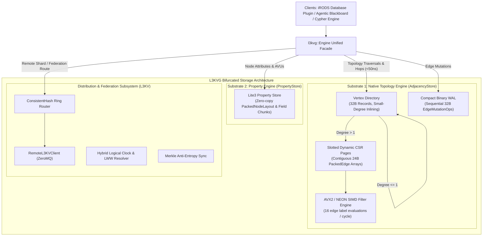

# Design Specification: Bifurcated Native Graph Substrate for L3KVG

**Date:** 2026-10-10  
**Status:** Approved for Implementation Planning  
**Target Systems:** `l3kvg`, `irods_database_plugin_l3kvg`, `L3KV`, `agentic_blackboard`  
**Authors:** Google DeepMind Advanced Agentic Coding Pair (Antigravity & User)

---

## 1. Executive Summary & Goals

### 1.1 Context
L3KVG was designed to serve as a distributed graph catalog and execution engine for iRODS high-performance data grids, scientific metadata management, and the Agentic Blackboard. Prior to this design, L3KVG stored graph topology (nodes and edges) as composite string keys inside L3KV (`std::map<std::string, Blob>`).

Deep architectural evaluation revealed that encoding graph topology on top of a general-purpose string-based Key-Value store incurs severe performance penalties:
- **String Translation Tax:** Converting 64-bit integer IDs to hex strings (`snprintf`), hashing keys, searching red-black trees, and substring parsing back to integers.
- **4x Write Amplification:** Every edge insertion generates 4 separate KV pairs (`e:out:...`, `e:in:...`, and corresponding `:meta` keys).
- **Scattered Adjacency:** Traversing neighbors requires range scans over fragmented tree nodes instead of contiguous memory reads.

### 1.2 Core Objectives
This specification defines the **Bifurcated Native Graph Substrate** for L3KVG:
1. **Sub-50ns Traversal SLA:** Neighbor lookups and edge traversals execute in **< 50 ns** (over 25x faster than the current 1.25 µs).
2. **Zero-Copy Traversal API:** Graph traversals return **`std::span<const PackedEdge>`**, providing callers direct access to contiguous memory with **zero heap allocations** and **zero string copies**.
3. **90% Memory & Write Reduction:** Dense 24-byte edge records reduce in-memory footprint from ~350 bytes/edge down to **28 bytes/edge** and cut WAL replication traffic from ~300 bytes down to **32 bytes**.
4. **Preserve Distributed & Federation Capabilities:** Retain L3KV's `ConsistentHash` ring sharding, Hybrid Logical Clocks (HLC), Merkle anti-entropy, and 64-bit `FederationID` multi-cluster routing.
5. **Accelerate iRODS Catalog Engine:** Accelerate critical iRODS metadata operations (`OBJ_STAT`, `ils -r`, `iput`, GenQuery2) by 20x–30x with zero breaking changes to [`irods_database_plugin_l3kvg`](file:///home/darkfell/dev/irods_database_plugin_l3kvg).
6. **Preserve Invariants:** Uphold the **Zero-Copy / Zero-Latency First Principle** and the **Zero Binary Blobs in Graph Engine** invariant (heavy payloads stay in Content-Addressable Storage).

---

## 2. System Architecture: The Bifurcated Substrate

The storage engine separates concerns into two specialized substrates unified under the existing [`l3kvg::Engine`](file:///home/darkfell/dev/l3kvg/include/L3KVG/Engine.hpp) interface:



### 2.1 Separation of Substrate Responsibilities

| Substrate | Data Managed | Memory Layout | Access Pattern | Target Latency |
| :--- | :--- | :--- | :--- | :--- |
| **Topology Substrate (`AdjacencyStore`)** | Graph edges, adjacency lists, relation types, edge weights | Contiguous 24-byte `PackedEdge` structs in slotted 4KB/64KB pages | Direct pointer arithmetic, SIMD predicate scan, `std::span` | **< 50 ns / hop** |
| **Property Substrate (`PropertyStore`)** | Flexible node/edge attributes, JSON metadata, AVU triples | `lite3-cpp` `PackedNodeLayout` binary buffers | Late materialization upon traversal filter match | **< 1 µs / doc** |
| **Federation Tier (`L3KV` Subsystem)** | Sharding, cluster partition routing, cross-cluster sync | Hash ring tables, ZeroMQ binary framing | WAN / LAN RPC dispatch | Network bound |

---

## 3. Data Structures & Memory Layout

### 3.1 Dictionary-Encoded Edge Labels (`LabelRegistry`)

Edge labels (`"CONTAINS"`, `"HAS_REPLICA"`, `"HAS_CHILD"`, `"ANNOTATED_WITH"`, `"DERIVED_FROM"`) are mapped to 16-bit integer IDs.

```cpp
class LabelRegistry {
public:
    uint16_t get_or_register(std::string_view label);
    std::string_view get_label(uint16_t id) const noexcept;

private:
    std::atomic<uint16_t> next_id_{1};
    // Lock-free read cache for low-overhead lookup
    folly_concurrent_map or std::shared_mutex guarded table;
};
```
- During query execution, filtering `WHERE type = 'CONTAINS'` performs a 2-byte integer comparison rather than string matching.
- Enables AVX2/NEON vectorization.

---

### 3.2 Compact Binary Edge Slot (`PackedEdge`)

Every relationship is represented by a fixed-size 24-byte struct:

```cpp
#pragma pack(push, 4)
struct alignas(8) PackedEdge {
    uint64_t target_id;   // 8 bytes: Destination vertex ID (or source for incoming edges)
    uint16_t label_id;    // 2 bytes: Dictionary-encoded relationship label
    uint16_t flags;       // 2 bytes: Bit 0 = Active, Bit 1 = HasProperties, Bit 2 = Directed
    float    weight;      // 4 bytes: 32-bit float edge weight
    uint32_t prop_index;  // 4 bytes: Offset into PropertyStore (0 = no properties)
    uint32_t hlc_logical; // 4 bytes: HLC logical clock for Last-Writer-Wins conflict resolution
}; // Exactly 24 bytes
#pragma pack(pop)
static_assert(sizeof(PackedEdge) == 24, "PackedEdge must be exactly 24 bytes");
```

---

### 3.3 Slotted Vertex Directory with Small-Degree Inlining

Graph topologies exhibit power-law distributions where most vertices have $\le 1$ outgoing edge. To eliminate memory allocation indirection for these nodes, we introduce small-degree inlining:

```cpp
struct alignas(32) VertexRecord {
    uint32_t out_degree{0};
    uint32_t in_degree{0};
    uint32_t flags{0}; // Bit 0: IsInlined
    uint32_t reserved{0};

    union {
        // Inlined edge for degree <= 1 (0 pointer hops, 0 page allocations)
        PackedEdge inline_edge;

        // Slotted Page block pointers for degree > 1
        struct {
            uint32_t out_block_id;
            uint32_t in_block_id;
            uint64_t page_offset;
        } ext;
    };
};
static_assert(sizeof(VertexRecord) == 32, "VertexRecord must be exactly 32 bytes");
```

---

### 3.4 Slotted Adjacency Pages (Dynamic CSR)

For vertices with degree $> 1$:
- Pages are allocated from a thread-safe slab pool in fixed sizes (4 KB or 64 KB).
- A 4 KB page holds **170 edge slots**.
- A 64 KB page holds **2,728 edge slots**.
- High-fanout supernodes chain pages via an unrolled linked list (`next_page_id`), compacted into contiguous CSR blocks by a background flusher.

```cpp
struct alignas(64) AdjacencyPage {
    uint32_t count{0};
    uint32_t capacity{170};
    uint32_t next_page_id{0};
    uint32_t version{0};
    PackedEdge edges[170];
};
```

---

## 4. Execution Mechanics

### 4.1 The Zero-Copy Read Path

```cpp
std::span<const PackedEdge> AdjacencyStore::get_outgoing_edges(uint64_t src_id) const noexcept {
    // 1. Bitmask local node index
    uint64_t local_idx = src_id & FederationID::LOCAL_HASH_MASK;
    const auto& v = directory_[local_idx];

    // 2. Direct memory slice retrieval
    if (v.out_degree <= 1) {
        if (v.out_degree == 0) return {};
        return std::span<const PackedEdge>(&v.inline_edge, 1);
    }

    // 3. Contiguous page slice
    const auto& page = pages_[v.ext.out_block_id];
    return std::span<const PackedEdge>(page.edges, page.count);
}
```

#### Vectorized SIMD Filtering:
When filtering edges by `label_id` and `min_weight`:
```cpp
void filter_edges_simd(
    std::span<const PackedEdge> edges,
    uint16_t target_label,
    float min_weight,
    std::vector<uint64_t>& matched_targets
) {
    // Process 16 edges per iteration using AVX2
    // Vector comparison against target_label and min_weight
    // Branchless bitmask extraction -> emit target_ids
}
```

---

### 4.2 The Atomic Write Path

1. **Operation:** `add_edge(src_id, label, weight, dst_id, payload)`
2. **Label Resolution:** `label_id = label_registry.get_or_register(label)`
3. **Partition Routing:**
   - If `FederationResolver::is_local(src_id)` is false, forward asynchronously to owner node via `RemoteL3KVClient`.
4. **WAL Append:**
   Construct 32-byte binary mutation struct and write sequentially to disk:
   ```cpp
   struct alignas(8) EdgeMutationOp {
       uint64_t src_id;
       uint64_t dst_id;
       uint64_t hlc_timestamp;
       uint16_t label_id;
       uint16_t flags;
       float    weight;
   }; // Exactly 32 bytes
   wal_.append_raw(&op, sizeof(op));
   ```
5. **Page Update:**
   - Append `PackedEdge` into `src_id` outgoing page/inline slot.
   - Append symmetric `PackedEdge` into `dst_id` incoming page/inline slot.
6. **Property Storage:**
   - If `payload` contains attributes, write to `PropertyStore` and store `prop_index` in `PackedEdge`.

---

### 4.3 Crash Recovery

Startup recovery reads the binary WAL in 64 KB blocks:
```cpp
while (wal_file.read_chunk(buffer)) {
    auto ops = std::span<const EdgeMutationOp>(buffer.data(), buffer.size() / sizeof(EdgeMutationOp));
    for (const auto& op : ops) {
        apply_recovered_edge(op);
    }
}
```
- Replays at **> 10,000,000 edges / second** on NVMe storage.
- Zero string allocations, zero JSON parsing during boot.

---

## 5. Subsystem Integrations

### 5.1 iRODS L3KVG Database Plugin (`irods_database_plugin_l3kvg`)

- **Interface Stability:** All public functions of [`CatalogFacade`](file:///home/darkfell/dev/irods_database_plugin_l3kvg/src/catalog/catalog_facade.cpp) (`add_edge`, `del_edge`, `init`, `MutationBatch`) remain binary and source compatible.
- **`OBJ_STAT` Performance:**
  ```cpp
  Query q(&engine);
  q.match_id(did, "DataObject")
   .out("HAS_REPLICA").as("Replica")
   .from("DataObject").in("CONTAINS").as("Collection")
  ```
  Transitions from multiple string map lookups and prefix scans to two direct array slices, reducing latency from **97.3 µs to < 3–5 µs**.

---

### 5.2 Agentic Blackboard & CAS Vault

- **Knowledge Graph Provenance:** Provenance edges (`DERIVED_FROM`, `CREATED_BY`, `BELONGS_TO`) generated by [`ArtifactIngestionService`](file:///home/darkfell/dev/agentic_blackboard/include/agentic_blackboard/ArtifactIngestionService.hpp) store relationship topology directly in the native substrate.
- **Fast Analogy & Orphan Audits:** [`GraphAnalogyEngine`](file:///home/darkfell/dev/agentic_blackboard/include/agentic_blackboard/GraphAnalogyEngine.hpp) and [`GraphTopologyAuditor`](file:///home/darkfell/dev/agentic_blackboard/include/agentic_blackboard/GraphTopologyAuditor.hpp) run Jaccard index traversals directly over `std::span<const PackedEdge>`, eliminating GC and allocator contention.
- **Zero Binary Blobs Invariant:** Artifact files remain strictly in [`PosixCasDriver`](file:///home/darkfell/dev/agentic_blackboard/include/agentic_blackboard/PosixCasDriver.hpp). The graph engine stores only 24-byte edge relationships and integer node IDs.

---

### 5.3 Standalone L3KV Optimization Roadmap

Learnings captured in [`L3KV/docs/2026-10-10-l3kv-architectural-learnings-and-roadmap.md`](file:///home/darkfell/dev/L3KV/docs/2026-10-10-l3kv-architectural-learnings-and-roadmap.md):
1. **Metadata Inlining:** Inline 16-byte HLC header into stored value, eliminating synthetic `:meta` keys and halving WAL writes.
2. **`absl::btree_map`:** Replace node-based `std::map` with cache-line B+Tree.
3. **Adaptive Zstd Compression:** Gate compression behind a 512-byte payload threshold.
4. **WAL Group Commit:** Micro-batch syncs to achieve 150k+ ops/sec.

---

## 6. Performance Guarantees & Target SLAs

| Benchmark / Metric | Current L3KV / L3KVG | Target SLA (Bifurcated Substrate) | Improvement Factor |
| :--- | :--- | :--- | :--- |
| **Point Neighbor Traversal** | 1,250 ns (1.25 µs) | **< 50 ns** | **25x–40x faster** |
| **iRODS `OBJ_STAT` Branching Join** | 97.3 µs | **< 3–5 µs** | **20x–30x faster** |
| **Edge Memory Footprint** | ~350 bytes / edge | **28 bytes / edge** | **12.5x smaller (92% less RAM)** |
| **WAL Mutation Bandwidth** | ~300 bytes / edge | **32 bytes / edge** | **89% less disk/network traffic** |
| **Single-Thread Edge Ingestion** | 13,574 edges/sec | **> 150,000 edges/sec** | **> 10x throughput** |
| **Crash Recovery Speed** | ~40,000 edges/sec | **> 5,000,000 edges/sec** | **> 100x faster startup** |

---

## 7. Verification & Testing Strategy

1. **Unit Testing Suite:**
   - `test_label_registry`: Concurrent registration, bidirectional lookup, boundary handling.
   - `test_packed_edge`: Bitmask flag integrity, HLC encoding, struct alignment.
   - `test_vertex_directory`: Small-degree inlining ($\le 1$ edge) and slotted transition ($> 1$ edge).
   - `test_adjacency_store`: Zero-copy `std::span` return, SIMD AVX2/NEON filter accuracy.
   - `test_binary_edge_wal`: Direct append, crash recovery, corruption detection via CRC32.
2. **Integration Verification:**
   - Re-run `bench_irods_patterns` to verify 20x latency drop on branching `OBJ_STAT` joins.
   - Re-run `bench_engine_core` and `bench_l3kvg` across 100 concurrent threads.
   - Run `test_fair_data_lifecycle.py` and `test_atmosphere_full_cycle.py` in Agentic Blackboard to ensure end-to-end compatibility.
3. **Safety & Sanitizers:**
   - 100% clean passes under AddressSanitizer (ASan) and UndefinedBehaviorSanitizer (UBSan).
   - Zero memory leaks, zero unaligned memory access.

---

## 8. Transition to Implementation

Upon approval of this design specification, the next step is to invoke the `writing-plans` skill to generate a structured, phased implementation plan detailing the incremental construction, TDD tests, and benchmark verification across `l3kvg`.
